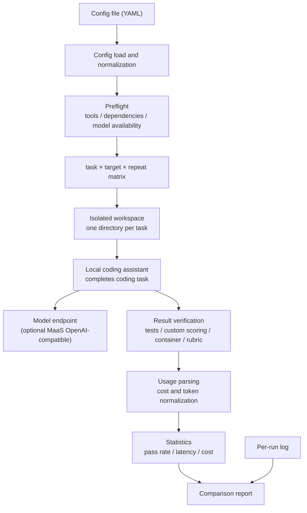

# application-intelligence-agent-cost-benchmark · agent-cost-bench

**How much does the same model cost across different coding CLIs? Which model delivers the best quality for your actual codebase?** `agent-cost-bench` answers both questions in a single run.
This repository is a **Huawei Cloud application-intelligence practice sample**. The tool itself is a **cloud-agnostic, local-first Python CLI**: it benchmarks AI coding agents by parsing each agent's own telemetry (cost, tokens, latency) and scoring the code those agents produce — it needs no cloud account to run and ships **no Terraform / no cloud infrastructure**. The only thing that talks to a model backend is the model endpoint you point a CLI at; for the bundled `pi` runner we document the **Huawei Cloud MaaS** OpenAI-compatible endpoint, but any OpenAI-compatible endpoint works.
Bring any model, any CLI, and any use case — a real GitHub repo with your own verification tests — and `agent-cost-bench` will measure cost, quality, and latency side by side.

## 1. Overview

### What you can do

| Question | Mode | Example |
|----------|------|---------|
| How does Sonnet 4.6 compare in Kiro vs Claude Code vs Copilot vs Codex? | `cli-compare` | Compare USD cost, latency, and pass rate for the same tasks |
| How do Opus, Sonnet, and other models stack up inside the Kiro CLI? | `model-compare` | Compare quality scores + cost across models |
| Does GPT-5.5 through Codex beat Sonnet 4.6 through Kiro on *my* brownfield repo? | `cli-compare` | Clone your repo into the task workspace; verify with your own tests |

The framework is designed to be flexible:

- **Any CLI** — Kiro, Claude Code, GitHub Copilot, Cursor, OpenAI Codex, Antigravity, OpenCode, Devin, pi, Qoder - Currently supported CLI's.
- **Any model** — Anthropic (Claude), OpenAI (o-series, GPT-5.x), or anything your CLI exposes, including models served through **Huawei Cloud MaaS** (OpenAI-compatible).
- **Any use case** — greenfield tasks included out of the box, or bring your own GitHub repo (public or private). The framework clones it, hands it to the model, and verifies the result.
- **Multiple verification options** — pytest, Docker containers, custom scorers, or LLM-judge rubrics. Pick the one that fits; no verification code is required for rubric-graded tasks.

Cost is always reported two ways: USD and native units (credits / AI Credits / tokens).

### Bring your own tasks (Terminal-Bench 2.1)

Want more tasks to compare CLIs on than the ones bundled here? You can pull in tasks from
[Terminal-Bench](https://github.com/harbor-framework/terminal-bench-2-1) and run your CLIs against them. The framework imports Terminal-Bench 2.x tasks (Harbor layout: `task.toml` +
`instruction.md` + `environment/` + `tests/`; older 1.x layouts are handled too), converts each
to a native fixture, and grades it with the task's **own** hidden test suite — giving you a pool
of real, third-party tasks for the cost/quality comparison without authoring them yourself.

> **This is "bring Terminal-Bench tasks into this framework," not "run the Terminal-Bench
> benchmark."** The two harnesses execute differently, and that difference matters:
>
> - **Terminal-Bench** runs the agent *inside* the task's container, so the agent can install
>   packages, build binaries, and start services that its tests then check.
> - **This framework** runs each CLI on the *host* and copies only the files it produces (under
>   `src/`) into a fresh container for grading. Anything the agent installs into its host
>   environment does not reach the grading container.
>
> The practical consequence: tasks that only require the agent to **produce files** (transform
> data, write a program, fix code) grade correctly and are great for comparing CLIs. Tasks that
> require the agent to **mutate the container environment** (e.g. "install R", "build `pmars`
> into `/usr/local/bin`", "run a web server") cannot be graded faithfully here — the framework
> detects and skips those rather than scoring them as model failures. So treat Terminal-Bench
> here as a *source of extra comparison tasks*, not as a way to reproduce Terminal-Bench scores.
> If you need faithful Terminal-Bench leaderboard numbers, use Terminal-Bench's own harness.

**Curated default.** Because a large share of the suite assumes in-container execution, a
`terminal-bench` source with **no explicit `tasks:` filter** defaults to a small, curated set of
tasks that have been confirmed to grade correctly under this host-agent model (rather than
running all ~89 and reporting a wall of structural failures). Set `tasks:` explicitly to run any
tasks you choose — the curated default only applies when you don't. The confirmed set lives in
`agent_cost_bench/importers/terminal_bench.py` (`_TERMINAL_BENCH_SUPPORTED`) and grows as runs
confirm more tasks are gradeable.

**How grading is bridged.** The importer emits a Docker `verify:` block (`parser: reward-file`)
that copies the model's `src/` into the task image, runs the task's own test script, and reads
the reward it writes. The imported prompt instructs the model to place its solution under `src/`,
and any input files the task references (e.g. `/app/data.txt`) are seeded into the workspace so
the model can read them.

### Option A — declare a task source in your config (imported at run time)

Add a `task_sources:` list to either config schema. Tasks are converted the moment you run,
staged under `<workspace_base>/.imported-tasks/`, and discovered like any other task.

`path` can be a **local directory** or a **git URL**. When it is a git URL, the framework
clones the repository into its own cache (`<workspace_base>/.repo_cache/`) on first use and
imports from there — you don't have to download anything by hand:

```yaml
task_sources:
  # Auto-cloned from GitHub — nothing to download first:
  - type: terminal-bench
    path: https://github.com/laude-institute/terminal-bench
    ref: main                                 # branch, tag, or full 40-char commit SHA
    subdir: tasks                             # repo subdirectory that holds the tasks
    # tasks: [chess-best-move, write-compressor]  # optional: pick specific source task names.
    #   Omit to use the curated harness-compatible default set (see above).
    # token_env: GITHUB_TOKEN                 # for a PRIVATE repo over HTTPS (env var NAME)

  # Or a local checkout (ref/subdir/depth/token_env are ignored for a local path):
  - type: terminal-bench
    path: ~/benchmarks/terminal-bench/tasks   # a task dir, or a directory of task dirs
```

Then run as usual — `agent-cost-bench cli-compare run config.yaml`. Imported ids are prefixed
(`terminal-bench-<name>`), so you can still target them with `task_ids:` or `--task`.

> **Task sources are exclusive.** When any enabled `task_sources` entry is present, the run uses
> **only** the imported tasks — the repo's own `tasks/` tree is skipped — so an imported-task run
> isn't diluted by the bundled sample tasks. Remove or disable the `task_sources` block
> (`enabled: false`) to go back to running the local `tasks/`. `tasks_dir` is still read from the
> config but ignored while a task source is active.
>
> With no `tasks:` filter, only the curated harness-compatible default set is imported (see the
> "Curated default" note above). Set `tasks:` to override that and pick your own.

#### Caveats for git task sources

- **Verify the repo URL and `subdir`.** The framework imports whatever task directories it finds
  under the cloned path; it does not validate that a given URL is the "official" benchmark. Point
  `path` at the real repository and set `subdir` to the folder that actually holds the tasks
  (Harbor layout). A wrong URL or `subdir` surfaces as "no tasks found," not as a download error.
- **`git` must be installed and on `PATH`.** Cloning shells out to `git` (with a transport
  allowlist and no interactive credential prompts). On Windows use [Git for Windows](https://git-scm.com/download/win).
  This is the only external dependency the clone path needs.
- **The clone is cached and not auto-refreshed.** Each URL + `ref` is cloned once into
  `<workspace_base>/.repo_cache/<url_hash>/<ref>/` and reused on every later run — parallel runs
  share a single fetch. It is **not** re-fetched automatically, so if `ref` is a moving branch
  (e.g. `main`) that advances on the remote, you keep getting the originally-cloned snapshot. Pin `ref`
  to a full 40-char commit SHA for reproducibility. To force a fresh clone, delete the cache:
  `rm -rf <workspace_base>/.repo_cache`.
- **Windows filesystem notes.** The cache/clean-up logic is OS-agnostic and has been made
  Windows-safe: publishing a freshly-cloned tree retries to ride out transient antivirus/indexer
  file locks, and directory cleanup clears the read-only bit that git sets on objects under
  `.git`. If a clone still fails to publish on Windows, an antivirus or search indexer is likely
  holding a handle on the files — retry, or exclude your `workspace_base` directory from real-time
  scanning. (These paths were validated by simulating the failure modes on POSIX; a real Windows
  smoke test is the final confirmation.)

### Option B — convert once into `tasks/` (inspect and edit the fixtures)

```bash
# Import every task from a directory of Terminal-Bench tasks
agent-cost-bench import-tasks --type terminal-bench --path ~/terminal-bench/tasks

# Import only named tasks
agent-cost-bench import-tasks --type terminal-bench --path ~/tb/tasks \
    --task hello-world --task fix-permissions

# Import tasks into a custom root
agent-cost-bench import-tasks --type terminal-bench --path ~/tb/tasks --into tasks

# Import AND build the Docker images now (otherwise they build on first run)
agent-cost-bench import-tasks --type terminal-bench --path ~/tb/tasks --build
```

Each import writes a native `tasks/<mode>/<id>/` fixture (a `task.yaml` plus the copied
`verify/tests/`, the task's `environment/` build context, and the oracle solution under
`reference/`). Tasks that ship a Dockerfile get their image built automatically on first
run (see the Docker image note below).

> **Docker image.** These tasks are graded in the benchmark's own container. When the
> `task.toml`/manifest names a prebuilt `docker_image`, it is used as-is. When the task
> ships only a `Dockerfile`, the importer copies its build context to `verify/environment/` and
> records `verify.build_context` in the generated `task.yaml`. **The framework builds the image
> automatically** the first time the task runs (and reuses it on later runs) — no manual build
> step. You can also build eagerly at import time with `import-tasks --build`, or build it
> yourself. If a build fails or the daemon is down, that task is reported as a harness error
> (not a model failure) and the others still run.

### Reward parsing

Imported tasks score with the `reward-file` parser, which reads the reward the task's verifier
writes (Harbor's convention is `/logs/verifier/reward.txt`). It accepts a float in `[0, 1]`
(graduated reward), an integer `passed total` / `passed/total` pair, a binary `1`/`0`, or a
small `{"reward": ...}` / `{"passed": .., "total": ..}` JSON object. If a task exits without
writing a reward, the runner synthesizes one from the exit code.

---

## 2. Table of Contents

- [1. Overview](#1-overview)
- [2. Table of Contents](#2-table-of-contents)
- [3. Architecture Diagram](#3-architecture-diagram)
- [4. Highlights](#4-highlights)
- [5. Cloud Services Used](#5-cloud-services-used)
- [6. Prerequisites](#6-prerequisites)
- [7. Quick Start](#7-quick-start)
- [8. Step-by-Step Deployment](#8-step-by-step-deployment)
- [9. Usage / Verification](#9-usage--verification)
- [10. Cleanup](#10-cleanup)
- [11. Detailed Explanation](#11-detailed-explanation)
- [12. Dependencies](#12-dependencies)
- [13. FAQ / Troubleshooting](#13-faq--troubleshooting)
- [14. Contributing](#14-contributing)
- [15. License](#15-license)
- [16. Contact / Maintainers](#16-contact--maintainers)

---

## 3. Architecture Diagram

This practice is a local-first AI coding assistant evaluation tool. Its overall flow:



The tool runs as a Python CLI and does not depend on cloud infrastructure: it reads the user's configuration and local task set, invokes locally installed coding assistants to complete coding tasks, then verifies and scores the results. The only step that may involve the network is the model endpoint called by the coding assistant; this practice recommends pointing that endpoint at the Huawei Cloud Model as a Service (MaaS) OpenAI-compatible interface, and other OpenAI-compatible endpoints also work. See [Architecture](docs/architecture.md) for details.

---

## 4. Highlights

- **Local-first**: evaluation logic runs locally and requires no cloud account; whether network is needed depends only on the chosen assistant's model endpoint.
- **Unified core**: cli-compare and model-compare share the execution and reporting core, with configuration-layer adaptation to avoid logic forks.
- **Isolated workspaces**: each task runs in its own directory to prevent file changes from interfering across assistants.
- **Repeated evaluation and statistics**: supports multiple runs of the same task and presents stability via pass rates and confidence intervals rather than a single result.
- **MaaS-compatible endpoint**: recommends pointing the model endpoint at the Huawei Cloud MaaS OpenAI-compatible interface for comparison under a unified yardstick.

---

## 5. Cloud Services Used

This tool is a local-first Python CLI and deploys no cloud resources itself. The only cloud service potentially involved is the optional **Huawei Cloud Model as a Service (MaaS)** — its OpenAI-compatible endpoint provides model inference for coding assistants; any OpenAI-compatible endpoint can be used instead. The tool depends on no Terraform or cloud infrastructure.

---

## 6. Prerequisites

- **Python 3.10+**
- **The coding CLI(s) you want to benchmark**, installed and logged in:
  - `cli-compare`: the CLIs you list as runners (e.g. `kiro-cli`, `claude`, `copilot`, `agent`, `codex`, `agy`, `opencode`, `devin`, `pi`)
  - `model-compare`: the Kiro CLI
- **Docker** — only if you run the multi-language tasks (C#/.NET, Java,
  TypeScript, Helm). Build images once with `./tasks/docker/build-images.sh`.
  Alternatively, set `CONTAINER_RUNTIME=finch` to use [Finch](https://github.com/runfinch/finch)
  instead of Docker (default is `docker`). When using Finch, set `workspace_base`
  in your config to a path under your home directory (e.g. `~/bench-workspaces`)
  since Finch on macOS can only mount volumes from the home directory.

> **Cost warning:** Each CLI you benchmark requires your own active subscription or license (Kiro, Claude Code, GitHub Copilot, Cursor, OpenAI Codex, Devin, etc.). Running benchmarks consumes credits, tokens, or premium requests against your account. A full run across all tasks can use significant resources. Start with a small subset (`task_ids:`) to estimate cost before running the full suite.
> **Note:** No cloud account or cloud infrastructure is required to run this benchmark — it is a local-first tool. The only cloud interaction is whatever model endpoint your chosen CLI calls.

---

## 7. Quick Start

### Install

```bash
git clone https://github.com/huaweicloud-samples/application-intelligence-agent-cost-benchmark.git
cd application-intelligence-agent-cost-benchmark
pip install -e .            # installs the `agent-cost-bench` command
pip install -e ".[dev]"     # optional: dev/test extras
```

### Interactive runner (`run.sh`)

If you'd rather not clone, install, and hand-write a config yourself, the repo ships a self-contained interactive runner that walks you through the whole thing. It's the fastest way to go from zero to a rendered cost comparison, and it runs **entirely on your machine — no cloud provider, no container orchestration, no Docker socket, no external secret store involved**.

```bash
./run.sh            # interactive, full flow
```

The script drives a `cli-compare` run through four steps:

1. **Preflight** — checks for the tools it needs (`git`, `python3`, `curl`, and `npm` if you pick an npm-based CLI) and tells you exactly what's missing before doing anything.
2. **Install** — clones the benchmark fresh into a timestamped per-run folder, creates an isolated virtualenv, installs `agent-cost-bench`, and installs the vendor CLIs for the runners you selected.
3. **Configure** — lets you pick which CLIs to compare, queries each CLI for its own available models so you can choose from a live list, collects and caches API keys, handles CLIs that need an interactive login, and generates a valid `config.yaml` for you.
4. **Run** — runs the benchmark on this host, writes the HTML/JSON report into a local results directory, and opens the report at the end.

### Why use it

- **No config authoring.** It generates a correct `cli-compare` config — including the fiddly per-CLI `cli_base_args`, pricing blocks, and the flags each CLI actually needs — so you don't have to copy an example and get the details right by hand.
- **Guided model selection.** For each CLI it runs that CLI's own "list models" command and shows a numbered picker, falling back to a sensible default when a CLI can't list. No guessing model slugs.
- **Authentication handled for you.** It knows which CLIs use an env-var API key versus an interactive login, prompts only where a key applies, and offers to run the login command for the rest. Entered keys are cached (chmod 600) so you only type each one once.
- **Fresh + reproducible.** Each run gets its own clone and venv, isolated from other runs, and records the exact commit it checked out.
- **Safe by default.** Input for keys is hidden, cached secrets are masked in logs, and the `.env` cache is kept private. Keep that `.env` out of git.

> **What the script prompts for vs. what it defaults.** `run.sh` only asks you to choose the **CLIs to compare**, a **model per CLI**, the global **effort**, and (optionally) a report **label**. Every other config key is written with a fixed default — it does **not** prompt for them. If you need to change any of these, edit the generated `config.yaml` (its path is printed during the run) and re-run with `--config <that file>`, or write your own config from `config.cli-compare.example.yaml`. The baked-in defaults are:
>
> | Config key | Default written by `run.sh` | What it means |
> |------------|-----------------------------|---------------|
> | `judge_cli_path` | `kiro-cli` | CLI used as the LLM judge for rubric-graded tasks (needs Kiro installed + authenticated) |
> | `judge_model` | `claude-opus-4.8` | Model the judge uses to grade |
> | `judge_weight` | `0.6` | Weight of the judge score in the blended result |
> | `modes` | `["vibe"]` | cli-compare runs vibe tasks only |
> | `task_ids` | *(empty)* | Runs **all** bundled tasks — including Docker-graded ones, which need a local Docker daemon |
> | `concurrency` | `per_target` | Parallelism strategy |
> | `timeout_minutes` | `20` | Per-task timeout |
> | `repeats` | `1` | Runs each task once |
> | `functional_pass_threshold` | `0.99` | Score needed to count as a PASS |
> | `workspace_base` | `/tmp/agent-cost-bench-cli-compare` | Where per-task workspaces are created |
> | `devin_permissions_file` | `tasks/devin/config.json` | Scoped Devin permission policy copied into each workspace |
> | `output_dir` | `results` | Report directory inside the run's benchmark checkout (final reports are also copied to `acb-results/<runId>`) |
> | `open_report` | `false` | The harness doesn't auto-open; `run.sh` opens the HTML itself unless `--no-open` |
>
> Note the empty `task_ids` means a plain run executes the **entire** bundled task suite, some of which require Docker. To run a subset, edit `task_ids:` in the generated config and re-run with `--config`.

### Common flags

```bash
./run.sh --yes                  # accept defaults (Kiro + Claude Code, opus)
./run.sh --skip-install         # reuse the most recent clone/venv, skip installs
./run.sh --no-open              # don't open the report at the end
./run.sh --config path.yaml     # use an existing config, skip all prompts
./run.sh --no-save-keys         # don't cache entered API keys to .env
./run.sh --label "Opus shootout" # set the report's comparison label
./run.sh --effort high          # global reasoning effort: low|medium|high
./run.sh --help                 # full usage
```

A single global `--effort` (default `high`) is applied across all CLIs — via the `{effort}` flag for CLIs that take one, or appended to the model slug for the rest. Per-task effort in a `task.yaml` still overrides it.

You can also point environment variables at custom locations: `BENCH_REPO_REF` (branch/tag/SHA to clone), `BENCH_HOME` (workspace root), `RESULTS_DIR` (where reports land), and `ACB_ENV_FILE` (the cached-keys file).

> **Cost warning applies here too.** The runner benchmarks against your own subscriptions and consumes credits/tokens/premium requests. It defaults to running all bundled tasks.

### Quick start

#### Step 1: Copy an example config

Example configs are provided as templates. **Copy them and fill in your specific details** — never edit the `*.example.yaml` files directly (they serve as reference).

```bash
# For CLI comparison (Kiro vs Claude Code vs Copilot vs Cursor vs Codex vs Devin):
cp config.cli-compare.example.yaml config.cli-compare.yaml

# For model comparison (multiple models inside the Kiro CLI):
cp config.model-compare.example.yaml config.model-compare.yaml
```

Then edit your copy with your specific paths, model IDs, and pricing rates (see below).

> **Prefer not to hand-write a config?** The interactive runner script does all of steps 1–3 for you — see [Interactive runner](#interactive-runner-runsh) above.

#### Step 2: Set up authentication

Each CLI reads its API key from standard environment variables. Set these in your shell before running:

```bash
export KIRO_API_KEY=...          # Kiro (or use `kiro-cli login`)
export ANTHROPIC_API_KEY=...     # Claude Code (or use `claude login`)
export GITHUB_TOKEN=...          # Copilot (or use `copilot auth login`)
export CURSOR_API_KEY=...        # Cursor (or use `cursor login`)
export OPENAI_API_KEY=...        # Codex (or use `codex auth login`)
# Antigravity: use `agy login`
# OpenCode: use `opencode auth login` (or the provider's own env var, e.g.
#     GITHUB_TOKEN for github-copilot, ANTHROPIC_API_KEY / OPENAI_API_KEY)
# Devin: use `devin auth login` (no corresponding environment variable)
# pi: point it at an OpenAI-compatible endpoint (e.g. Huawei Cloud MaaS) via
#     OPENAI_BASE_URL / OPENAI_API_KEY, or the provider's own credentials.
#     Verify with: pi auth check --provider <name> --json
# Qoder: use `qoder login`
```

The harness inherits the parent shell's environment, so all CLIs pick up their keys automatically — no per-runner `env:` block needed.

#### Step 3: Configure pricing

Pricing rates are volatile and change over time. Check each vendor's current pricing page before running. The example configs include inline comments with rates that were current at the time of writing, but **you are responsible for verifying these match your subscription tier and current published rates**.

##### Pricing reference (verify before use)

| CLI | Pricing config | Reference |
|-----|----------------|-----------|
| **Kiro** | `usd_per_credit: 0.04` | Credits consumed fractionally per task; check your plan's credit value |
| **Claude Code** | No pricing config needed — reports `total_cost_usd` directly | Direct API billing; cost reported in CLI JSON output |
| **GitHub Copilot** | No pricing config needed — cost derived from AI-credit (AIU) telemetry in the JSON output, 1 AIU = $0.01 USD | — |
| **Cursor** | Token-level rates (see below) | [cursor.com/docs/models-and-pricing](https://cursor.com/docs/models-and-pricing) |
| **OpenAI Codex** | Token-level rates (see below) | [platform.openai.com/docs/pricing](https://platform.openai.com/docs/pricing) |
| **Antigravity** | Token-level rates (see below) | Verify the per-token rates for your chosen `agy` model |
| **OpenCode** | Provider cost read directly from the JSON output; token-level rates optional as a fallback (see below) | Rates depend on the provider you configure in OpenCode |
| **Devin** | Token-level rates (see below) | `devin models list` prints per-MTok rates per model slug |
| **pi** | No pricing config needed — prices each turn from its bundled model catalog and reports USD | `pi --list-models` shows the catalog; token rates may be supplied as a fallback for unpriced models |
| **Qoder** | `usd_per_credit` (e.g. `0.02`) — cost is `total_credits` × rate from the `-o json` result; unknown if the rate is omitted | Qoder reports `total_cost_usd: 0`, so cost is derived from credits; check your plan's credit value |

##### Token-level pricing (Cursor, Codex, and Devin)

These CLIs report raw token counts; the harness computes cost using rates you supply. Example for Cursor with Opus 4.8:

```yaml
pricing:
  usd_per_input_token:        0.000005     # $5.00  / 1M (fresh input)
  usd_per_cache_write_token:  0.00000625   # $6.25  / 1M (cache write)
  usd_per_cached_input_token: 0.0000005    # $0.50  / 1M (cache read)
  usd_per_output_token:       0.000025     # $25.00 / 1M
```

Example for Codex with GPT-5.5:

```yaml
pricing:
  usd_per_input_token:        0.000005     # $5.00  / 1M
  usd_per_cached_input_token: 0.0000005    # $0.50  / 1M
  usd_per_output_token:       0.000030     # $30.00 / 1M
```

> **Important:** These rates change. Always cross-reference with the vendor's pricing page. Different models have different rates — update the pricing block when you change `model_id`.

##### Cost source auto-detection

The harness automatically detects how to read cost from each CLI based on its binary name.

> **Kiro cost reporting requires `--output-format stream-json`.** On current kiro-cli (v3 default engine; observed on 2.23.0), a run still executes and is scored in plain-text mode, but credit/cost telemetry is only emitted in the stream-json event stream, so cost is reported as `null` without it. The bundled Kiro runner sets this flag. Older CLI versions printed a plain-text `▸ Credits:` banner. The cost parser is backward compatible: it reads credits from the stream-json event stream when present and otherwise falls back to the legacy `▸ Credits:` banner, so both current and older kiro-cli versions are handled automatically.

### cli-compare — same tasks, different CLIs

*"How much does Sonnet 4.6 cost through Kiro vs Claude Code vs Copilot? How does Opus 4.8 compare across all four CLIs plus Cursor?"*

```bash
agent-cost-bench cli-compare run config.cli-compare.yaml
```

The example config defines runners for Kiro, Claude Code, Copilot, Cursor, Antigravity, OpenCode, Devin, pi, and Qoder. Cost is auto-detected from the binary name — you provide the CLI path, model ID, and pricing rates:

```yaml
runners:
  - name: kiro
    display_name: "Kiro (claude-opus-4.8)"
    cli_path: kiro-cli
    model_id: claude-opus-4.8
    pricing:
      usd_per_credit: 0.04
    cli_base_args: [chat, --no-interactive, --trust-all-tools,
                    --output-format, stream-json,   # credits telemetry (kiro-cli 2.32+)
                    "--model={model}", "--effort={effort}"]

  - name: claude-code
    display_name: "Claude Code (claude-opus-4.8)"
    cli_path: claude
    model_id: us.anthropic.claude-opus-4-8
    cli_base_args: ["-p", "{prompt}", "--output-format", "json",
                    "--model", "{model}", "--dangerously-skip-permissions",
                    "--effort", "{effort}"]

  - name: copilot
    display_name: "GitHub Copilot (claude-opus-4.8)"
    cli_path: copilot
    model_id: claude-opus-4.8
    pricing:
      usd_per_premium_request: 0.04
    cli_base_args: ["-p", "{prompt}", "--model", "{model}",
                    "--allow-all-tools", "--output-format", "json",
                    "--effort", "{effort}"]

  - name: cursor
    display_name: "Cursor (claude-opus-4.8)"
    cli_path: agent
    model_id: claude-opus-4-8
    pricing:
      usd_per_input_token:        0.000005
      usd_per_cache_write_token:  0.00000625
      usd_per_cached_input_token: 0.0000005
      usd_per_output_token:       0.000025
    cli_base_args: ["-p", "{prompt}", "--trust", "--yolo",
                    "--output-format", "json", "--model", "{model}"]

  - name: devin
    display_name: "Devin (claude-opus-4.8)"
    cli_path: devin
    model_id: claude-opus-4-8
    pricing:
      usd_per_input_token:        0.000005
      usd_per_cached_input_token: 0.0000005
      usd_per_output_token:       0.000025
      devin_export_file: devin-usage.json
    cli_base_args: ["-p", "{prompt}", "--model", "{model}",
                    "--export", "devin-usage.json"]
```

> **Note:** Cursor, Devin, and Antigravity encode effort/thinking level as part of the model slug (e.g., `claude-opus-4-8-high`, `gemini-3.8-flash-high`), not as a separate flag. The harness auto-appends the task's effort level to the `model_id` unless you bake it in yourself. This is what keeps a cross-CLI run fair — every runner ends up on the same model at the same reasoning effort even though they spell it differently.

#### Antigravity specifics

The Antigravity CLI (`agy`) reports cost from `agy -p "<prompt>" --output-format json`, which prints a single JSON object with a `usage` block (`input_tokens`, `output_tokens`, `thinking_tokens`, `cache_read_tokens`). Cost is computed per-token like Cursor/Codex: `input_tokens × input_rate + cache_read_tokens × cached_rate + output_tokens × output_rate`. `thinking_tokens` is a subset of `output_tokens` and is reported but not billed separately.

Like Cursor and Devin, Antigravity bakes the reasoning effort **into the model slug** rather than taking a separate `--effort` flag. `agy models` lists ids such as `gemini-3.8-flash-high` / `-medium` / `-low`, `gemini-3.1-pro-high` / `-low`, and `gpt-oss-120b-medium`. So the runner passes only `--model`, and you either set `model_id` to a full slug that already carries the effort, or set it to the base slug (`gemini-3.8-flash`) and let the harness append the task's effort (`-high`/`-medium`/`-low`) — the same mechanism used for Cursor and Devin, which keeps a cross-CLI run fair.

```yaml
- name: antigravity
  display_name: "Antigravity (gemini-3.8-flash)"
  cli_path: agy
  model_id: gemini-3.8-flash   # base slug; harness appends the effort (-high/…)
  cost_source: antigravity_json
  pricing:
    usd_per_input_token:  0.00000075   # $0.75 / 1M (fresh input)
    usd_per_output_token: 0.00000375   # $3.75 / 1M
    # usd_per_cached_input_token:       # add from the Gemini API pricing page
  cli_base_args: ["-p", "{prompt}", "--output-format", "json",
                  "--model", "{model}", "--add-dir", "{workspace}",
                  "--print-timeout", "30m",
                  "--dangerously-skip-permissions"]
```

The rates above are Gemini 3.8 Flash's introductory pricing ($0.75/1M input, $3.75/1M output) from [Google's announcement](https://blog.google/innovation-and-ai/models-and-research/gemini-models/3-8-flash-and-3-8-flash-cyber/).

> **Caveat:** These are introductory rates and may change — verify against the current Gemini API pricing page before trusting cost numbers, and update the block whenever you change `model_id`. The announcement publishes no cache-read rate, so `usd_per_cached_input_token` is left unset and cache reads fall back to the full input rate; supply it from the API pricing page (Gemini cached input is typically 25% of the input rate) to avoid overstating cost in agentic runs where most prompt tokens are cache hits.

Two `agy`-specific flags in the block above are **not optional** for the benchmark — leaving either out produces a failing run that looks like a model failure:

- **`--add-dir {workspace}`** — `agy` ignores the process working directory and writes generated files into its own managed scratch dir (`~/.gemini/antigravity-cli/...`) unless the run workspace is passed as an **absolute** path via `--add-dir`. The harness substitutes `{workspace}` with the run's absolute workspace path so files land where the verifier looks. A relative `.` does **not** work — `agy` resolves it against its scratch dir, not cwd. Without this, verification finds no code and scores 0%.
- **`--print-timeout 30m`** — `agy`'s print mode aborts itself after **5 minutes** by default and returns `{"status":"ERROR","error":"timeout waiting for response"}` with a partial or empty result. Large tasks need longer, so raise it to comfortably exceed the harness `timeout_minutes`. This is `agy`'s own timeout, independent of the harness timeout. Symptom when too low: a truncated result and a low pass rate from partial files.

**Tips for running Antigravity:**

- **Log in first** with `agy`, and confirm your account can use the model you set — run `agy models` and copy an exact id (base slug like `gemini-3.8-flash`, or a full slug like `gemini-3.8-flash-high`).
- **Expect slower wall-clock times.** In practice Gemini 3.8 Flash spent several minutes on the larger multi-file tasks. Budget headroom in both `--print-timeout` and the harness `timeout_minutes`.
- **Sanity-check the result status** in the run log's `RESPONSE` block: it should read `"status":"SUCCESS"`, not `"status":"ERROR"`. An `ABNORMAL EXIT ... exit 1` line for the antigravity target means `agy` returned a non-success result — read the `error` field to see why. Two common ones:
  - `"timeout waiting for response"` → the print timeout was hit; raise `--print-timeout`.
  - `"Individual quota reached. Please upgrade your subscription..."` → your Antigravity account hit its usage quota (the message includes when it resets). This is an account limit, not a config problem — the run will score 0% until the quota resets or you upgrade. Watch for this when running several large tasks in a row.
- **If the pass rate is unexpectedly 0%**, first read the `RESPONSE` status/error (quota or timeout above), then check where files landed. If the response's `file://` links point under `~/.gemini/antigravity-cli/` instead of the run workspace, `--add-dir {workspace}` is missing or was passed as a relative path.
- **Cost is derived from token counts, not a billed dollar figure** (`agy` reports no `total_cost_usd`), so accuracy depends entirely on the per-token rates you configure. Update them whenever you change `model_id`.

#### Devin specifics

Devin has no JSON output mode, so cost comes from the ATIF conversation export written by `--export <file>`. The path is relative to the CLI's working directory (the run's workspace), and `pricing.devin_export_file` must match the `--export` filename so the parser can find it.

`devin models list` publishes only input and output rates (`--format json` exposes the same `cost_summary` string and nothing more), so **you must supply `usd_per_cached_input_token` yourself** — use the underlying provider's published cache-read price. This matters more than it looks: `total_prompt_tokens` is inclusive of `total_cached_tokens`, and cache reads are typically ~90% of prompt tokens in an agentic run. Omitting the rate makes the parser fall back to the full input price and overstates Devin's cost by roughly 5x, which would make a CLI comparison meaningless.

Devin's non-interactive mode **silently rejects any tool call that would need approval**, which would fail every task. Rather than hand it a blanket auto-approve flag, the harness copies a scoped permission policy into each workspace as `.devin/config.json`:

```yaml
devin_permissions_file: tasks/devin/config.json   # default
```

The shipped policy allows workspace reads/writes plus an explicit allowlist of build and test commands (`python`, `pytest`, `npm`, `go`, `cargo`, `make`, `git`, common POSIX utilities, …) and **denies** credential paths (`~/.ssh`, cloud-provider credential dirs, `**/.env`, `**/*.pem`), config-directory writes, and `sudo` / `ssh` / `git push` / `gh` / cloud CLIs. Deny rules win over allow rules. If your tasks need a command that isn't listed, add an `Exec(<command>)` entry — an unlisted command is rejected, not prompted. Set `devin_permissions_file: ""` to skip the copy entirely.

The policy allows the shell, which makes that deny list a speed bump rather than a boundary: `bash -c "<denied command>"` still runs, because the inner command is only an argument. Containment comes from the disposable per-run workspace, not from the policy — do not run the suite against a `workspace_base` holding anything you care about. Denying the shell was tried and rejected: an allowlist cannot be both airtight and complete across a heterogeneous task suite, and the gaps scored as model failures rather than policy failures. For the same reason `curl`/`wget` are **allowed** — denying them bought nothing once the shell was permitted, while the other runners already have network access under `--trust-all-tools` / `--dangerously-skip-permissions`, so the deny only manufactured a capability gap in the runner being measured. Egress restriction, if you want it, belongs at the sandbox or network layer and must apply to every runner equally. `tasks/devin/config.json` documents the full reasoning and the CLI's exact matching semantics.

Print mode cannot display Devin's interactive workspace-trust prompt and aborts in an untrusted directory. Trust is inherited by child directories, so run `devin` once interactively in your `workspace_base` and approve it — every per-run workspace created underneath is then trusted, and no flag is needed. Prefer this to `--respect-workspace-trust false`, which turns the check off for the whole run; add the flag only where nobody can approve interactively, such as CI.

> Do **not** point Devin's `--config` flag at a file you intend to commit: the CLI writes session state (including your `org_id`) back into it.

#### pi specifics (OpenAI-compatible / MaaS)

The `pi` coding agent is a bring-your-own-provider CLI: it talks to any OpenAI-compatible endpoint (such as **Huawei Cloud MaaS**, which exposes an `/v1/chat/completions` surface compatible with the OpenAI SDK) and prices each turn itself from a bundled model catalog. `pi -p --mode json` streams JSON Lines, and every `turn_end` event carries both token counts and a USD cost:

```json
{"type":"turn_end","message":{"provider":"openai",
  "model":"meta-llama_Llama-3.1-8B-Instruct",
  "usage":{"input":3,"output":70,"cacheRead":0,"cacheWrite":6512,
    "cost":{"input":0.000009,"output":0.00105,"cacheRead":0,
            "cacheWrite":0.02442,"total":0.025479}}}}
```

The harness sums `cost.total` across every `turn_end`, so **no pricing block is required** — the same arrangement as Claude Code. Per-token rates are honoured only as a fallback for a model the catalog does not price. `usage.input` is the fresh, non-cached prompt slice, reported alongside `cacheRead` / `cacheWrite`, so total input is the sum of the three.

```yaml
- name: pi
  display_name: "pi (Llama-3.1-8B via MaaS)"
  cli_path: pi
  model_id: meta-llama_Llama-3.1-8B-Instruct
  cli_base_args: ["-p", "--mode", "json",
                  "--provider", "openai", "--model", "{model}",
                  "--thinking", "{effort}",
                  "--no-session", "--no-approve", "{prompt}"]
```

Set the endpoint and key through environment variables before running:

```bash
export OPENAI_BASE_URL="https://<your-maas-endpoint>/v1"   # Huawei Cloud MaaS, or any OpenAI-compatible URL
export OPENAI_API_KEY="<your-endpoint-key>"
```

Notes on the flags:

- **`--provider`** — `pi`'s default provider is `google`, so pass the provider you are actually authenticated against or the run fails at the first turn. For an OpenAI-compatible endpoint use `openai`. Check readiness with `pi auth check --provider openai --json` (expect `"status":"ready"`), and list the exact model ids with `pi --list-models`. Alternatively encode both in one value: `--model openai/<model-id>`.
- **`--thinking {effort}`** — `pi` takes the reasoning level as a flag (`off`, `minimal`, `low`, `medium`, `high`, `xhigh`, `max`), which lines up with the task's `effort` value directly. No model-slug suffix games as with Cursor/Devin/Antigravity.
- **`--no-session`** — keeps each benchmark run stateless instead of appending to `~/.pi` session storage.
- **`--no-approve`** — ignores project-local `pi` config, extensions, and skills found in the workspace. Worth keeping for a brownfield task that clones a repo you do not control: without it, files in the cloned tree could influence the run.
- **`-p` implies non-interactive**, and built-in `read`/`write`/`edit`/`bash` tools are enabled without an approval prompt in this mode, so no "dangerously skip permissions"-style flag is needed. `pi` writes into the process working directory, so files land in the run workspace with no `--add-dir`-style flag required.

#### OpenCode specifics

OpenCode is a bring-your-own-provider CLI: you point it at whatever provider you have configured (GitHub Copilot, Anthropic, OpenAI, …) and it reports the provider's own cost. `opencode run --format json` streams JSONL events, and the harness reads token counts and cost from every `step_finish` event:

```json
{"type":"step_finish","part":{"tokens":{"total":N,"input":N,"output":N,
  "reasoning":N,"cache":{"write":N,"read":N}},"cost":0.02973}}
```

A single task usually produces several `step_finish` events (one per step of the agent loop), so the harness sums both tokens and cost across all of them. The `cost` field is the provider's direct USD figure and takes precedence; if it is missing or zero but tokens are present, the harness falls back to computing cost from the per-token `pricing` block. That makes the pricing block **optional** — supply it only as a fallback, and match the rates to the provider behind your `model_id`.

```yaml
- name: opencode
  display_name: "OpenCode (Gemini 3.8 Flash)"
  cli_path: opencode
  model_id: github-copilot/gemini-3.8-flash
  pricing:
    usd_per_input_token:        0.00000075   # $0.75  / 1M
    usd_per_cached_input_token: 0.000000135  # $0.135 / 1M
    usd_per_output_token:       0.00000375   # $3.75  / 1M
  cli_base_args: ["run", "--format", "json",
                  "--dir", "{workspace}", "--model", "{model}",
                  "--variant", "{effort}", "--auto", "{prompt}"]
```

Notes on the flags:

- **`--dir {workspace}`** — OpenCode does not use the process working directory; pass the run workspace explicitly so generated files land where the verifier looks. The harness substitutes `{workspace}` with the run's absolute workspace path.
- **OpenCode requires a git repository.** It refuses to operate in a non-git directory, so the harness auto-runs `git init` in any non-repo workspace before the CLI starts (a no-op for repo tasks, which already have `.git` from the clone). Nothing to configure.
- **`--model`** takes a `provider/model` slug (e.g. `github-copilot/gemini-3.8-flash`). Run `opencode models` to list the exact ids your configured provider exposes, and make sure `opencode auth login` (or the provider's env var) is set for that provider.
- **`--variant {effort}`** — OpenCode takes reasoning effort as a separate flag (provider-specific values such as `high`, `max`, `minimal`), so the harness passes the task's `effort` straight through. No model-slug suffix games as with Cursor/Devin/Antigravity.
- **`--auto`** runs non-interactively and auto-approves any tool call that is not explicitly denied, so no separate "skip permissions" flag is needed.
- **Cost accuracy** depends on the provider reporting a `cost` in its `step_finish` events. When it does, the pricing block is ignored; when it does not, the fallback rates you supply are used, so keep them current and update them whenever you change `model_id`.

### model-compare — same CLI, different models

*"Which model gives the best quality inside the Kiro CLI?"*

```bash
agent-cost-bench model-compare run config.model-compare.yaml
```

```yaml
models:
  - claude-opus-4.8
  - claude-sonnet-4.6
  - deepseek-3.2
pricing: { usd_per_credit: 0.04 }
judge_model: claude-opus-4.8    # grades rubric + spec quality tasks
modes: ["vibe"]                 # or ["vibe", "spec-driven"]
```

### Bring your own repo

Any task can reference a GitHub repository. The framework clones it (cached across models), places it in the workspace, and the model works against your real code:

```yaml
# task.yaml
id: fix-my-auth-bug
mode: vibe
prompt: "Fix the failing test in tests/test_auth.py"
effort: medium            # low / medium / high — per-task, based on complexity
repo:
  url: https://github.com/my-org/my-service.git
  ref: a1b2c3d4e5f6...   # pin to a commit SHA for reproducibility
  token_env: GITHUB_TOKEN # for private repos
verify:
  runner: pytest
  deps: [pytest, httpx]
```

### Effort level

Set `effort` in each task's `task.yaml` to control how much reasoning the model applies:

```yaml
# Simple formatting task — low reasoning is fine
effort: low

# Complex multi-file refactor — give the model time to think
effort: high
```

Valid values: `low`, `medium`, `high` (default: `high`). A run-level fallback (`effort:` in the main config) still works for backward compatibility — per-task settings override it.

### Useful commands

```bash
agent-cost-bench cli-compare validate config.cli-compare.example.yaml        # check setup
agent-cost-bench model-compare list-tasks config.model-compare.example.yaml  # see tasks
agent-cost-bench report results/<run_id>.json                                # rebuild HTML
agent-cost-bench new-task my-task                                            # scaffold (rubric)
agent-cost-bench new-task my-task --with-tests                               # scaffold (pytest)
agent-cost-bench import-tasks --type terminal-bench --path ~/tb/tasks        # import external tasks
```

Reports (HTML + JSON) are written to `results/` and open automatically.

---

## 8. Step-by-Step Deployment

This practice is a local tool with no cloud infrastructure to deploy. The step-by-step install, configure, and run flow is in the [Deployment Guide](docs/deployment-guide.md):

1. **Install**: create and activate a virtualenv in the repo root (`python3 -m venv .venv`; `source .venv/bin/activate`, on Windows `.venv\Scripts\activate`), then `pip install -e .`, and verify with `agent-cost-bench --help`.
2. **Prepare credentials and endpoint**: set API keys for the chosen CLI; for assistants that need a user-specified endpoint such as `pi`, point at an OpenAI-compatible endpoint (Huawei Cloud MaaS recommended) via `OPENAI_BASE_URL` / `OPENAI_API_KEY`.
3. **Choose a run mode**: interactive with `./run.sh`; manual by copying `config.*.example.yaml` to a real config and editing keys such as `runners` / `models`, `task_ids`, `effort`.
4. **Run the benchmark**: `agent-cost-bench cli-compare --config config.cli-compare.yaml` or `agent-cost-bench model-compare --config config.model-compare.yaml`.
5. **View results**: check the comparison report and per-run logs under `results/`.

---

## 9. Usage / Verification

### How verification works

After a model finishes a task, the framework scores its output. Four options — pick what fits your task:

#### 1. Python tests (`verify: { runner: pytest }`)

Put test files in the task's `verify/` folder (the model never sees them). List pip dependencies under `deps`. The framework handles the venv.

```yaml
verify:
  runner: pytest
  deps: ["fastapi==0.104.1", "httpx==0.27.2", "pytest==9.0.3"]
```

#### 2. Custom scorer (`verify: { runner: local }`)

Write `verify/score.py` to inspect the workspace and print a graduated score.

```yaml
verify:
  runner: local
  deps: ["python-hcl2==4.3.5"]
  score: verify/score.py
```

#### 3. Docker (`verify: { image: ... }`)

For non-Python tasks. Tests run in a prebuilt image — no local toolchain needed.

```yaml
verify:
  image: agent-cost-bench-node:20
  parser: vitest-json
  workdir: src
  tests_subdir: verify/tests
  test_cmd: 'vitest run --reporter=json --outputFile="$RESULTS_DIR/vitest.json"'
```

#### 4. LLM judge rubric (`quality.rubric`)

No verification code needed. List plain-English criteria and the judge grades each one.

```yaml
quality:
  rubric:
    - "notes_cli.py is created in the workspace"
    - "'add <text>' appends the note as a new line to notes.txt"
    - "'search' is case-insensitive"
```

#### Partial credit

Any verifier can report a graduated score (0.0–1.0):

```
AGENT_COST_BENCH_RESULT: {"score": 0.7, "checkpoints": {...}, "summary": "..."}
```

#### Pass threshold

`functional_pass_threshold` in `task.yaml` sets the score needed for a PASS (default: 0.99). Lower it for rubric tasks that rarely need perfection.

#### Run the test suite

```bash
pytest    # unit + integration; uses a MockCLI, no network or real CLI needed
```

Key checks on results: the comparison report covers pass rate, latency, and usage for each CLI / model; `<output dir>/<run id>.log` records per-run details; with repeats configured, the report gives pass rates and confidence intervals. If results look abnormal, read the per-run log first to determine whether the assistant execution failed, the verification config is wrong, or the endpoint is unavailable.

After deployment, follow these steps to verify that the business functionality works before considering the delivery complete.

---

## 10. Cleanup

This tool is a local Python CLI with no cloud infrastructure, so there are **no cloud resources to destroy**. To clean up local artifacts, delete the virtualenv you created (e.g. `.venv`), the task workspace directories under `workspace_base` and the report directory, and the `.env` file that `run.sh` uses to cache keys (do not commit it to version control). Reinstalling restores a clean environment.

---

## 11. Detailed Explanation

### Included tasks

Tasks live under `tasks/`. Two types:

- **vibe** — a single prompt; the model produces code that is verified. Run by both modes.
- **spec-driven** — full spec workflow (requirements → design → tasks → implementation). Model-compare only.

| Task | Type | Domain | What it tests |
|------|------|--------|---------------|
| `rest-api` | vibe | Python / FastAPI | Greenfield: CRUD Todo REST API |
| `dashboard` | vibe | Python + HTML/JS | Greenfield: full-stack Todo dashboard |
| `log-analyzer-cli` | vibe | Python | Greenfield: parse access logs into JSON |
| `note-cli` | vibe | Python | Greenfield: note-taking CLI (rubric graded) |
| `dockerize-flask` | vibe | Docker | Brownfield: add Dockerfile + compose |
| `helm-chart` | vibe | Helm / K8s | Production-ready Helm chart |
| `harden-k8s` | vibe | Kubernetes | Brownfield: security-harden manifests |
| `dotnet-invoicing` | vibe | C#/.NET (Docker) | Brownfield: fix invoice-pricing bugs |
| `java-ratelimiter` | vibe | Java (Docker) | Brownfield: fix rate-limiter bugs |
| `typescript-circuit-breaker` | vibe | TypeScript (Docker) | Brownfield: fix circuit-breaker bugs |
| `openai-compatible-sentiment` | vibe | Python / OpenAI-compatible | Implement tweet sentiment via an OpenAI-compatible endpoint (MaaS) (rubric graded) |
| `event-sourcing-cqrs` | vibe | Python (stdlib) | Greenfield high-complexity: event-sourcing/CQRS bank system (7 files, 32 tests) |
| `multitenant-rbac-api` | vibe | Python / FastAPI | Greenfield high-complexity: multi-tenant RBAC document API (7 files, 30 tests) |
| `multitenant-workflow-engine` | vibe | Python / FastAPI | Greenfield high-complexity: workflow state machine + SLA tracking (9 files, 42 tests) |
| `distributed-task-processor` | vibe | Python / FastAPI | Greenfield high-complexity: plugin task processor + event bus (12 files, 48 tests) |
| `ecommerce-order-saga` | vibe | Python / FastAPI | Greenfield high-complexity: order saga with compensation (15 files, 66 tests) |
| `ml-pipeline-orchestrator` | vibe | Python / FastAPI | Greenfield high-complexity: ML pipeline orchestrator + registry (14 files, 64 tests) |
| `platform-as-a-service` | vibe | Python / FastAPI | Greenfield high-complexity: multi-tenant PaaS backend (16 files, 72 tests) |
| `auth-feature` | spec-driven | Python | JWT auth: login, logout, refresh |

Select tasks with `task_ids:` in your config. Omit it to run everything.

> Rubric-graded tasks need `judge_model`. Docker tasks need Docker + prebuilt images.
>
> You can also bring in Terminal-Bench tasks as extra comparison tasks — see [Bring your own tasks](#bring-your-own-tasks-terminal-bench-21) above.
> The seven high-complexity tasks (`event-sourcing-cqrs` through `platform-as-a-service`) are greenfield multi-file applications (7-16 files, 30-72 pytest scenarios each) that stress multi-file architecture and cross-cutting concerns; they take ~5-22 min per run versus under 2 min for the single-file tasks.

### Supported CLIs and cost detection

| Binary name | What it reads |
|-------------|---------------|
| `kiro` / `kiro-cli` | `Credits: X • Time: Ys` telemetry line |
| `claude` | `--output-format json` → `total_cost_usd` |
| `copilot` | `--output-format json` JSONL + `~/.copilot/session-state/` `totalNanoAiu` |
| `codex` | `codex exec --json` → `turn.completed` token counts |
| `cursor` / `agent` | `-p --output-format json` → `usage` object with token counts |
| `agy` / `antigravity` | `-p --output-format json` → `usage` object with token counts |
| `devin` | `--export <file>` ATIF conversation export → `final_metrics` token counts |
| `pi` | `-p --mode json` JSONL → `turn_end` `usage.cost.total` (USD, summed over turns) |
| Any + per-token pricing | Custom regex with `(?P<input>...)` / `(?P<output>...)` groups |

### Security

`agent-cost-bench` benchmarks coding agents by **running them and the code they produce**. It is
a local-first tool with **no cloud account or cloud infrastructure required**. Please read
[SECURITY.md](SECURITY.md) before running it outside a throwaway environment. In short: running
it can result in arbitrary code execution as your user — run it in a disposable VM, CI runner, or
discardable container, not your primary workstation.

---

## 12. Dependencies

| Dependency | Requirement |
|---|---|
| Python | >= 3.10 |
| pyyaml | >= 6.0 |
| click | >= 8.1 |
| rich | >= 13.0 |
| jinja2 | >= 3.1.5 |
| pydantic | >= 2.0 |
| python-dateutil | >= 2.8 |
| Git | for pulling task repositories |
| Selected coding CLI(s) | installed and logged in per benchmark mode |
| Docker (optional) | for container-verification tasks; or set `CONTAINER_RUNTIME=finch` to use Finch |

Dev/test extras are in the `dev` group of `[project.optional-dependencies]` in `pyproject.toml`.

---

## 13. FAQ / Troubleshooting

### Troubleshooting

- **Spec runs hang** — native spec mode needs a TTY. The harness uses PTY by default (`spec_use_pty: true`). If your CLI reads from stdin, set `spec_prompt_via_stdin: true`.
- **Docker task fails** — run `agent-cost-bench <mode> validate <config>` to check images; build missing ones with `./tasks/docker/build-images.sh`.
- **Offline restore fails** — allow network for verification: `AGENT_COST_BENCH_VERIFY_NETWORK=bridge agent-cost-bench <mode> run <config>`.
- **Assistant not found** — confirm the assistant is installed, its executable is on PATH, and it is logged in.
- **Model endpoint unavailable** — check the endpoint address and key, and whether the network is reachable.
- **Runs take too long** — narrow the `task_ids` range or lower the repeat count; validate the flow with a small sample first.

---

## 14. Contributing

Bug reports and feature requests are welcome via GitHub Issues, and pull requests are welcome too. Before submitting, please ensure: work against the latest code on the *main* branch; check existing open and recently merged PRs to avoid duplication; open an issue to discuss significant work; local tests pass; fork the repository and commit with clear commit messages. See [CONTRIBUTING.md](CONTRIBUTING.md) and [CODE_OF_CONDUCT.md](CODE_OF_CONDUCT.md).

---

## 15. License

This practice is released under **MIT No Attribution**. See [LICENSE](LICENSE).

---

## 16. Contact / Maintainers
| Item | Content |
|---|---|
| **Creator** | [dgc-git](https://github.com/dgc-git) |
| **Maintainer** | [dgc-git](https://github.com/dgc-git) |
| **Contact** | GitHub Issues / PR (see [Section 14](#14-contributing)) |
