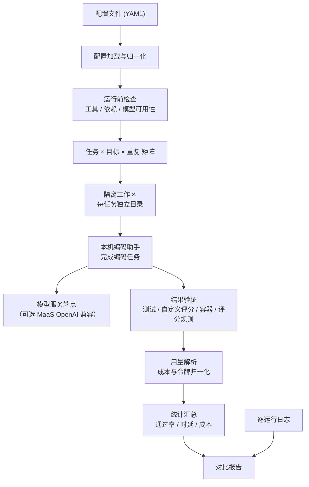

# application-intelligence-agent-cost-benchmark · agent-cost-bench

**同一个模型在不同的编码 CLI 中要花多少钱？哪个模型针对你的真实代码库能给出最优质量？** `agent-cost-bench` 一次运行即可回答这两个问题。
本仓库是一个**华为云应用智能实践样例**。工具本身是一个**云无关、本地优先的 Python CLI**：它通过解析各编码助手自身产生的遥测数据（成本、令牌数、时延）来对 AI 编码助手做基准评测，并对助手产出的代码打分——运行时不需要云账号，也**不含 Terraform / 云基础设施**。唯一与模型后端通信的环节，是你为某个 CLI 指向的模型端点；对于内置的 `pi` 运行器，我们记录了华为云 MaaS 的 OpenAI 兼容端点，但任何 OpenAI 兼容端点都可使用。
带上任意模型、任意 CLI 与任意用例——一个带有你自己的验证测试的真实 GitHub 仓库——`agent-cost-bench` 将并排衡量成本、质量与时延。

## 1. 简介 / Overview

### 你可以做什么

| 问题 | 模式 | 示例 |
|----------|------|---------|
| Sonnet 4.6 在 Kiro、Claude Code、Copilot 与 Codex 中表现如何？ | `cli-compare` | 对比相同任务的美元成本、时延与通过率 |
| Opus、Sonnet 等模型在 Kiro CLI 内如何横向比较？ | `model-compare` | 对比各模型的质量得分与成本 |
| 通过 Codex 使用 GPT-5.5 是否在我自己的存量代码库上胜过通过 Kiro 使用 Sonnet 4.6？ | `cli-compare` | 将你的仓库克隆到任务工作区，用你自己的测试验证 |

该框架设计灵活：

- **任意 CLI** —— Kiro、Claude Code、GitHub Copilot、Cursor、OpenAI Codex、Antigravity、OpenCode、Devin、pi、Qoder —— 当前支持的 CLI。
- **任意模型** —— Anthropic（Claude）、OpenAI（o 系列、GPT-5.x），或你的 CLI 暴露的任何模型，包括通过**华为云 MaaS** 提供服务的模型（OpenAI 兼容）。
- **任意用例** —— 开箱即包含绿地（greenfield）任务，也可带入自己的 GitHub 仓库（公开或私有）。框架会克隆它、交给模型处理并验证结果。
- **多种验证方式** —— pytest、Docker 容器、自定义评分器或 LLM 评审规则。按需选择；规则评分任务无需编写验证代码。

成本始终以两种方式报告：美元与原生单位（credits / AI Credits / tokens）。

### 自带任务（Terminal-Bench 2.1）

想要比内置任务更多的 CLI 对比任务？你可以从 [Terminal-Bench](https://github.com/harbor-framework/terminal-bench-2-1) 拉取任务，用自己的 CLI 运行。框架导入 Terminal-Bench 2.x 任务（Harbor 布局：`task.toml` + `instruction.md` + `environment/` + `tests/`；也兼容较旧的 1.x 布局），将每个任务转换为原生测试夹具，并使用任务**自带**的隐藏测试套件评分——无需自己编写，即可获得一批真实的第三方任务用于成本/质量对比。

> **这是"把 Terminal-Bench 任务带入本框架"，而不是"运行 Terminal-Bench 基准测试"。** 两套执行器的运行方式不同，这一差异很重要：
>
> - **Terminal-Bench** 在任务容器**内部**运行助手，因此助手可以安装包、编译二进制文件并启动服务，供其测试检查。
> - **本框架**在**宿主机**上运行各 CLI，只把助手产出的文件（`src/` 下的内容）复制到新容器中进行评分。助手安装到宿主机环境中的任何东西都不会进入评分容器。
>
> 实际后果是：只要求助手**产出文件**的任务（转换数据、编写程序、修复代码）能正确评分，非常适合对比 CLI；而要求助手**改变容器环境**的任务（例如"安装 R"、"把 `pmars` 编译到 `/usr/local/bin`"、"启动 Web 服务"）在此无法忠实评分——框架会检测并跳过这些任务，而不是把它们记为模型失败。因此请把此处的 Terminal-Bench 视为*额外的对比任务来源*，而不是复现 Terminal-Bench 分数的方式。如果需要忠实的 Terminal-Bench 排行榜数字，请使用 Terminal-Bench 自己的执行器。

**精选默认集。** 由于该套件中有相当一部分任务假设在容器内执行，未设置显式 `tasks:` 过滤器的 `terminal-bench` 来源默认使用一组经过确认、可在这种"宿主机助手"模式下正确评分的精选任务（而不是运行全部约 89 个任务并报告一大堆结构性失败）。显式设置 `tasks:` 即可运行你选择的任意任务——只有未设置时才应用精选默认集。已确认的任务集合位于 `agent_cost_bench/importers/terminal_bench.py`（`_TERMINAL_BENCH_SUPPORTED`），并会随着运行确认更多可评分任务而增长。

**评分如何桥接。** 导入器生成一个 Docker `verify:` 块（`parser: reward-file`），将模型的 `src/` 复制到任务镜像中，运行任务自带的测试脚本，并读取其写入的奖励值。导入后的提示词指示模型将解决方案放在 `src/` 下，任务引用的任何输入文件（例如 `/app/data.txt`）会预置到工作区，供模型读取。

### 方案 A — 在配置中声明任务来源（运行时导入）

在任一配置结构中添加 `task_sources:` 列表。任务在你运行时即被转换，暂存到 `<workspace_base>/.imported-tasks/`，并像普通任务一样被发现。

`path` 可以是**本地目录**或 **git URL**。当它是 git URL 时，框架首次使用时会把仓库克隆到自己的缓存（`<workspace_base>/.repo_cache/`）并从那里导入——你无需手动下载任何东西：

```yaml
task_sources:
  # 从 GitHub 自动克隆 —— 无需事先下载：
  - type: terminal-bench
    path: https://github.com/laude-institute/terminal-bench
    ref: main                                 # 分支、标签或完整的 40 位提交 SHA
    subdir: tasks                             # 仓库中存放任务的子目录
    # tasks: [chess-best-move, write-compressor]  # 可选：选择特定的来源任务名称。
    #   省略则使用精选的、与执行器兼容的默认集合（见上文）。
    # token_env: GITHUB_TOKEN                 # 用于通过 HTTPS 访问私有仓库（环境变量名）

  # 或使用本地检出（本地路径下 ref/subdir/depth/token_env 均被忽略）：
  - type: terminal-bench
    path: ~/benchmarks/terminal-bench/tasks   # 任务目录，或包含多个任务目录的目录
```

然后照常运行 —— `agent-cost-bench cli-compare run config.yaml`。导入的任务 ID 带有前缀（`terminal-bench-<name>`），因此你仍可用 `task_ids:` 或 `--task` 指定它们。

> **任务来源是互斥的。** 只要存在任何启用的 `task_sources` 条目，本次运行就**只**使用导入的任务——仓库自身的 `tasks/` 树会被跳过——这样导入任务的运行不会被内置示例任务稀释。移除或禁用 `task_sources` 块（`enabled: false`）即可回到运行本地 `tasks/`。启用任务来源期间，`tasks_dir` 仍会从配置中读取但被忽略。
>
> 未设置 `tasks:` 过滤器时，只导入精选的、与执行器兼容的默认集合（见上文"精选默认集"说明）。设置 `tasks:` 可覆盖它并选择你自己的任务。

#### git 任务来源的注意事项

- **核对仓库 URL 与 `subdir`。** 框架会导入在克隆路径下找到的任何任务目录；它不会验证某个 URL 是否是"官方"基准。请把 `path` 指向真实仓库，并把 `subdir` 设为实际存放任务的文件夹（Harbor 布局）。错误的 URL 或 `subdir` 表现为"未找到任务"，而不是下载错误。
- **必须安装 `git` 并加入 `PATH`。** 克隆通过调用 `git` 完成（带传输协议白名单，且无交互式凭据提示）。Windows 请使用 [Git for Windows](https://git-scm.com/download/win)。这是克隆路径所需的唯一外部依赖。
- **克隆会被缓存且不会自动刷新。** 每个 URL + `ref` 只克隆一次到 `<workspace_base>/.repo_cache/<url_hash>/<ref>/`，后续每次运行都复用——并行运行共享同一次拉取。它**不会**自动重新拉取，因此如果 `ref` 是持续推进的分支（例如 `main`），你会一直得到最初克隆时的快照。为可复现性，请将 `ref` 固定为完整的 40 位提交 SHA。要强制重新克隆，请删除缓存：`rm -rf <workspace_base>/.repo_cache`。
- **Windows 文件系统说明。** 缓存/清理逻辑与操作系统无关，并已做到 Windows 安全：发布新克隆的目录时会重试以度过杀毒软件/索引器的瞬时文件锁，目录清理会清除 git 在 `.git` 下对象上设置的只读位。如果克隆在 Windows 上仍无法发布，很可能是杀毒软件或搜索索引器占用了文件句柄——重试，或将你的 `workspace_base` 目录从实时扫描中排除。（这些路径已通过在 POSIX 上模拟失败模式验证；真实 Windows 冒烟测试是最终确认。）

### 方案 B — 一次性转换到 `tasks/`（检查并编辑测试夹具）

```bash
# 从 Terminal-Bench 任务目录导入所有任务
agent-cost-bench import-tasks --type terminal-bench --path ~/terminal-bench/tasks

# 只导入指定名称的任务
agent-cost-bench import-tasks --type terminal-bench --path ~/tb/tasks \
    --task hello-world --task fix-permissions

# 导入到自定义根目录
agent-cost-bench import-tasks --type terminal-bench --path ~/tb/tasks --into tasks

# 导入并立即构建 Docker 镜像（否则会在首次运行时构建）
agent-cost-bench import-tasks --type terminal-bench --path ~/tb/tasks --build
```

每次导入都会写入一个原生 `tasks/<mode>/<id>/` 测试夹具（一个 `task.yaml` 加上复制的 `verify/tests/`、任务的 `environment/` 构建上下文，以及 `reference/` 下的标准答案）。自带 Dockerfile 的任务会在首次运行时自动构建镜像（见下方 Docker 镜像说明）。

> **Docker 镜像。** 这些任务在该基准自身的容器中评分。当 `task.toml`/清单指定了预构建的 `docker_image` 时，将按原样使用。当任务只带 `Dockerfile` 时，导入器会把其构建上下文复制到 `verify/environment/`，并在生成的 `task.yaml` 中记录 `verify.build_context`。**框架会在任务首次运行时自动构建镜像**（后续运行复用）——无需手动构建步骤。你也可以在导入时用 `import-tasks --build` 提前构建，或自行构建。如果构建失败或守护进程未运行，该任务会报告为执行器错误（而非模型失败），其它任务仍会继续运行。

### 奖励解析

导入的任务使用 `reward-file` 解析器评分，它读取任务验证器写入的奖励值（Harbor 的约定是 `/logs/verifier/reward.txt`）。它接受 `[0, 1]` 范围内的浮点数（渐进式奖励）、整数 `passed total` / `passed/total` 对、二进制 `1`/`0`，或小型 `{"reward": ...}` / `{"passed": .., "total": ..}` JSON 对象。如果任务退出时未写入奖励，运行器会根据退出码合成一个。

---

## 2. 目录

- [1. 简介 / Overview](#1-简介--overview)
- [2. 目录](#2-目录)
- [3. 架构图](#3-架构图)
- [4. 方案亮点](#4-方案亮点)
- [5. 涉及云服务](#5-涉及云服务)
- [6. 前置条件](#6-前置条件)
- [7. 快速开始](#7-快速开始)
- [8. 分步部署](#8-分步部署)
- [9. 使用方法 / 验证](#9-使用方法--验证)
- [10. 清理资源](#10-清理资源)
- [11. 详细说明](#11-详细说明)
- [12. 依赖](#12-依赖)
- [13. FAQ / 故障排除](#13-faq--故障排除)
- [14. 贡献指南](#14-贡献指南)
- [15. 许可证](#15-许可证)
- [16. 联系方式 / 维护者](#16-联系方式--维护者)

---

## 3. 架构图

本实践是一个本地优先的 AI 编码助手评测工具，整体流程如下：



工具以 Python 命令行程序运行，不依赖云上基础设施：读取使用者的配置与本地任务集，调用本机已安装的编码助手完成编码任务，再对结果做验证与评分。唯一可能涉及网络的环节是编码助手调用的模型服务端点；本实践推荐将该端点指向华为云模型即服务（MaaS）提供的 OpenAI 兼容接口，也兼容其它 OpenAI 兼容端点。详见 [架构说明](docs/architecture.md)。

---

## 4. 方案亮点

- **本地优先**：评测逻辑在本机运行，不要求云账号；是否需要网络仅取决于所选编码助手的模型端点。
- **统一内核**：助手对比与模型对比两种模式共享执行与报告核心，配置层做差异化适配，避免逻辑分叉。
- **隔离工作区**：每个任务在独立目录执行，防止助手之间的文件改动相互干扰。
- **重复评测与统计**：支持对同一任务多次运行，用通过率与置信区间呈现稳定性，而非单次结果。
- **MaaS 兼容端点**：推荐将模型端点指向华为云 MaaS 的 OpenAI 兼容接口，便于在统一口径下对比模型。

---

## 5. 涉及云服务

本工具为本地优先的 Python 命令行程序，本身不部署任何云资源。唯一可能涉及的云服务是可选的**华为云模型即服务（MaaS）**——通过其 OpenAI 兼容端点为编码助手提供模型推理能力；也可替换为任意 OpenAI 兼容端点。工具不依赖 Terraform 或云基础设施。

---

## 6. 前置条件

- **Python 3.10+**
- **待评测的编码 CLI**，已安装并登录：
  - `cli-compare`：配置中列为运行器的 CLI（例如 `kiro-cli`、`claude`、`copilot`、`agent`、`codex`、`agy`、`opencode`、`devin`、`pi`）
  - `model-compare`：Kiro CLI
- **Docker** —— 仅在运行多语言任务（C#/.NET、Java、TypeScript、Helm）时需要。用 `./tasks/docker/build-images.sh` 构建镜像一次即可。也可设置 `CONTAINER_RUNTIME=finch` 使用 [Finch](https://github.com/runfinch/finch) 代替 Docker（默认为 `docker`）。使用 Finch 时，请将配置中的 `workspace_base` 设为主目录下的路径（例如 `~/bench-workspaces`），因为 macOS 上的 Finch 只能从主目录挂载卷。

> **成本提示：** 每个被评测的 CLI 都需要你自己的有效订阅或许可（Kiro、Claude Code、GitHub Copilot、Cursor、OpenAI Codex、Devin 等）。运行评测会消耗你账号下的 credits、tokens 或高级请求。跑完所有任务的完整评测可能消耗较多资源。建议先用一小部分任务（`task_ids:`）估算用量，再运行完整套件。
> **说明：** 运行该基准不需要云账号或云基础设施——它是一个本地优先工具。唯一的云端交互是所选 CLI 调用的模型端点。

---

## 7. 快速开始

### 安装

```bash
git clone https://github.com/huaweicloud-samples/application-intelligence-agent-cost-benchmark.git
cd application-intelligence-agent-cost-benchmark
pip install -e .            # 安装 `agent-cost-bench` 命令
pip install -e ".[dev]"     # 可选：开发/测试依赖
```

### 交互式运行（`run.sh`）

如果你不想自己克隆、安装并手写配置，仓库提供了一个自包含的交互式运行脚本，会引导你走完全流程。这是从零到生成成本对比报告的最快方式，且**完全在本机运行 —— 不涉及任何云服务商、容器编排、Docker socket 或外部密钥存储**。

```bash
./run.sh            # 交互式完整流程
```

脚本通过四个步骤驱动一次 `cli-compare` 运行：

1. **运行前检查** —— 检查所需工具（`git`、`python3`、`curl`，若选基于 npm 的 CLI 还需 `npm`），并在做任何事之前明确告知缺少什么。
2. **安装** —— 将基准重新克隆到一个带时间戳的每次运行独立目录，创建隔离的虚拟环境，安装 `agent-cost-bench`，并为所选运行器安装厂商 CLI。
3. **配置** —— 让你选择要对比的 CLI，查询每个 CLI 自身可用的模型以便从实时列表中选择，收集并缓存 API 密钥，处理需要交互式登录的 CLI，并为你生成有效的 `config.yaml`。
4. **运行** —— 在本机运行评测，把 HTML/JSON 报告写入本地结果目录，并在结束时打开报告。

### 为何使用它

- **无需手写配置。** 它生成正确的 `cli-compare` 配置——包括繁琐的每个 CLI 的 `cli_base_args`、定价块以及各 CLI 实际需要的标志——你不必复制示例再手工校对细节。
- **引导式模型选择。** 对每个 CLI，它运行该 CLI 自带的"列出模型"命令并显示带编号的选择器；当 CLI 无法列出时回退到合理默认值。无需猜测模型 slug。
- **替你处理认证。** 它知道哪些 CLI 使用环境变量 API 密钥、哪些需要交互式登录，只在适用处提示输入密钥，并主动为其余 CLI 运行登录命令。输入的密钥会被缓存（chmod 600），每个只需输入一次。
- **全新且可复现。** 每次运行都有独立的克隆与虚拟环境，与其它运行隔离，并记录检出的确切提交。
- **默认安全。** 密钥输入被隐藏，缓存的密钥在日志中被遮蔽，`.env` 缓存保持私有。请把该 `.env` 排除在 git 之外。

> **脚本会提示什么、默认什么。** `run.sh` 只询问你要对比的 **CLI**、每个 CLI 的**模型**、全局**投入级别（effort）**，以及可选的报告**标签**。其它所有配置键都以固定默认值写入——它**不会**逐项提示。如需修改其中任何一项，请编辑生成的 `config.yaml`（运行时会打印其路径）并用 `--config <该文件>` 重新运行，或从 `config.cli-compare.example.yaml` 编写自己的配置。内置默认值如下：
>
> | 配置键 | `run.sh` 写入的默认值 | 含义 |
> |------------|-----------------------------|---------------|
> | `judge_cli_path` | `kiro-cli` | 用于规则评分任务的 LLM 评审 CLI（需安装 Kiro 并完成认证） |
> | `judge_model` | `claude-opus-4.8` | 评审用于打分的模型 |
> | `judge_weight` | `0.6` | 评审得分在混合结果中的权重 |
> | `modes` | `["vibe"]` | cli-compare 仅运行 vibe 任务 |
> | `task_ids` | *（空）* | 运行**全部**内置任务——包括需要本地 Docker 守护进程的容器评分任务 |
> | `concurrency` | `per_target` | 并行策略 |
> | `timeout_minutes` | `20` | 每任务超时 |
> | `repeats` | `1` | 每个任务运行一次 |
> | `functional_pass_threshold` | `0.99` | 计为 PASS 所需分数 |
> | `workspace_base` | `/tmp/agent-cost-bench-cli-compare` | 每任务工作区的创建位置 |
> | `devin_permissions_file` | `tasks/devin/config.json` | 复制到每个工作区的限定范围 Devin 权限策略 |
> | `output_dir` | `results` | 运行基准检出内的报告目录（最终报告也会复制到 `acb-results/<runId>`） |
> | `open_report` | `false` | 执行器不自动打开；`run.sh` 会自行打开 HTML，除非指定 `--no-open` |
>
> 注意空的 `task_ids` 意味着普通运行会执行**整个**内置任务套件，其中部分任务需要 Docker。要运行子集，请在生成的配置中编辑 `task_ids:` 并用 `--config` 重新运行。

### 常用标志

```bash
./run.sh --yes                  # 接受默认值（Kiro + Claude Code，opus）
./run.sh --skip-install         # 复用最近的克隆/虚拟环境，跳过安装
./run.sh --no-open              # 结束时不开打报告
./run.sh --config path.yaml     # 使用已有配置，跳过所有提示
./run.sh --no-save-keys         # 不把输入的 API 密钥缓存到 .env
./run.sh --label "Opus shootout" # 设置报告的对比标签
./run.sh --effort high          # 全局推理投入：low|medium|high
./run.sh --help                 # 完整用法
```

单个全局 `--effort`（默认 `high`）应用于所有 CLI —— 对支持该标志的 CLI 使用 `{effort}` 标志，其余则附加到模型 slug。`task.yaml` 中的每任务 effort 仍可覆盖它。

你也可以通过环境变量指向自定义位置：`BENCH_REPO_REF`（要克隆的分支/标签/SHA）、`BENCH_HOME`（工作区根目录）、`RESULTS_DIR`（报告落地位置）和 `ACB_ENV_FILE`（缓存密钥文件）。

> **成本提示同样适用。** 该运行脚本针对你自己的订阅运行评测，并消耗 credits/tokens/高级请求。它默认运行全部内置任务。

### 快速上手

#### 第 1 步：复制示例配置

示例配置作为模板提供。**请复制后填入你自己的具体信息** —— 切勿直接编辑 `*.example.yaml` 文件（它们仅作参考）。

```bash
# 助手对比（Kiro vs Claude Code vs Copilot vs Cursor vs Codex vs Devin）：
cp config.cli-compare.example.yaml config.cli-compare.yaml

# 模型对比（Kiro CLI 内的多个模型）：
cp config.model-compare.example.yaml config.model-compare.yaml
```

然后编辑你的副本，填入具体路径、模型 ID 与定价费率（见下文）。

> **不想手写配置？** 交互式运行脚本会替你完成第 1–3 步 —— 见下方[交互式运行](#交互式运行-runsh)。

#### 第 2 步：设置认证

每个 CLI 从标准环境变量读取其 API 密钥。运行前请在 shell 中设置：

```bash
export KIRO_API_KEY=...          # Kiro（或使用 `kiro-cli login`）
export ANTHROPIC_API_KEY=...     # Claude Code（或使用 `claude login`）
export GITHUB_TOKEN=...          # Copilot（或使用 `copilot auth login`）
export CURSOR_API_KEY=...        # Cursor（或使用 `cursor login`）
export OPENAI_API_KEY=...        # Codex（或使用 `codex auth login`）
# Antigravity：使用 `agy login`
# OpenCode：使用 `opencode auth login`（或厂商自身的环境变量，例如
#     github-copilot 用 GITHUB_TOKEN，ANTHROPIC_API_KEY / OPENAI_API_KEY）
# Devin：使用 `devin auth login`（无对应的环境变量）
# pi：通过 OPENAI_BASE_URL / OPENAI_API_KEY 指向 OpenAI 兼容端点（例如华为云 MaaS），
#     或使用厂商自身的凭据。
#     用以下命令验证：pi auth check --provider <name> --json
# Qoder：使用 `qoder login`
```

执行器继承父 shell 的环境，因此所有 CLI 都会自动获取各自的密钥——无需为每个运行器配置 `env:` 块。

#### 第 3 步：配置定价

定价费率波动频繁，会随时间变化。运行前请查看各厂商当前的定价页面。示例配置带有撰写时费率的行内注释，但**你有责任核实这些费率与你的订阅档位及当前公布费率一致**。

##### 定价参考（使用前请核实）

| CLI | 定价配置 | 参考 |
|-----|----------------|-----------|
| **Kiro** | `usd_per_credit: 0.04` | credits 按任务 fractional 消耗；查看你的套餐 credit 价值 |
| **Claude Code** | 无需定价配置 —— 直接报告 `total_cost_usd` | 直接按 API 用量结算；成本在 CLI JSON 输出中报告 |
| **GitHub Copilot** | 无需定价配置 —— 成本由 JSON 输出中的 AI-credit（AIU）遥测推导，1 AIU = $0.01 USD | — |
| **Cursor** | 令牌级费率（见下文） | [cursor.com/docs/models-and-pricing](https://cursor.com/docs/models-and-pricing) |
| **OpenAI Codex** | 令牌级费率（见下文） | [platform.openai.com/docs/pricing](https://platform.openai.com/docs/pricing) |
| **Antigravity** | 令牌级费率（见下文） | 核实你所选 `agy` 模型的每令牌费率 |
| **OpenCode** | 直接读取 JSON 输出中的厂商成本；令牌级费率作为可选回退（见下文） | 费率取决于你在 OpenCode 中配置的厂商 |
| **Devin** | 令牌级费率（见下文） | `devin models list` 按模型 slug 打印每 MTok 费率 |
| **pi** | 无需定价配置 —— 按内置模型目录对每个回合计价并报告美元 | `pi --list-models` 显示目录；未定价模型可补充令牌费率作为回退 |
| **Qoder** | `usd_per_credit`（例如 `0.02`）—— 成本为 `-o json` 结果中的 `total_credits` × 费率；省略费率则成本未知 | Qoder 报告 `total_cost_usd: 0`，因此成本由 credits 推导；查看你的套餐 credit 价值 |

##### 令牌级定价（Cursor、Codex 与 Devin）

这些 CLI 报告原始令牌数；执行器使用你提供的费率计算成本。以 Opus 4.8 的 Cursor 为例：

```yaml
pricing:
  usd_per_input_token:        0.000005     # $5.00  / 1M（新输入）
  usd_per_cache_write_token:  0.00000625   # $6.25  / 1M（缓存写入）
  usd_per_cached_input_token: 0.0000005    # $0.50  / 1M（缓存读取）
  usd_per_output_token:       0.000025     # $25.00 / 1M
```

以 GPT-5.5 的 Codex 为例：

```yaml
pricing:
  usd_per_input_token:        0.000005     # $5.00  / 1M
  usd_per_cached_input_token: 0.0000005    # $0.50  / 1M
  usd_per_output_token:       0.000030     # $30.00 / 1M
```

> **重要：** 这些费率会变化。务必与厂商定价页面交叉核对。不同模型费率不同——更改 `model_id` 时请同步更新定价块。

##### 成本来源自动检测

执行器根据各 CLI 的可执行文件名称自动检测如何读取成本。

> **Kiro 成本报告需要 `--output-format stream-json`。** 在当前 kiro-cli（v3 默认引擎；在 2.23.0 上观察到）中，纯文本模式下运行仍会执行并评分，但 credit/成本遥测只在 stream-json 事件流中发出，因此不加该标志时成本报告为 `null`。内置的 Kiro 运行器已设置该标志。较旧的 CLI 版本会打印纯文本 `▸ Credits:` 横幅。成本解析器向后兼容：优先从 stream-json 事件流读取 credits，否则回退到旧的 `▸ Credits:` 横幅，因此当前与较旧的 kiro-cli 版本都能自动处理。

### cli-compare —— 相同任务，不同 CLI

*"Sonnet 4.6 通过 Kiro、Claude Code、Copilot 分别要花多少钱？Opus 4.8 在四个 CLI 加 Cursor 上表现如何？"*

```bash
agent-cost-bench cli-compare run config.cli-compare.yaml
```

示例配置为 Kiro、Claude Code、Copilot、Cursor、Antigravity、OpenCode、Devin、pi 和 Qoder 定义了运行器。成本根据可执行文件名称自动检测——你提供 CLI 路径、模型 ID 与定价费率：

```yaml
runners:
  - name: kiro
    display_name: "Kiro (claude-opus-4.8)"
    cli_path: kiro-cli
    model_id: claude-opus-4.8
    pricing:
      usd_per_credit: 0.04
    cli_base_args: [chat, --no-interactive, --trust-all-tools,
                    --output-format, stream-json,   # credits 遥测（kiro-cli 2.32+）
                    "--model={model}", "--effort={effort}"]

  - name: claude-code
    display_name: "Claude Code (claude-opus-4.8)"
    cli_path: claude
    model_id: us.anthropic.claude-opus-4-8
    cli_base_args: ["-p", "{prompt}", "--output-format", "json",
                    "--model", "{model}", "--dangerously-skip-permissions",
                    "--effort", "{effort}"]

  - name: copilot
    display_name: "GitHub Copilot (claude-opus-4.8)"
    cli_path: copilot
    model_id: claude-opus-4.8
    pricing:
      usd_per_premium_request: 0.04
    cli_base_args: ["-p", "{prompt}", "--model", "{model}",
                    "--allow-all-tools", "--output-format", "json",
                    "--effort", "{effort}"]

  - name: cursor
    display_name: "Cursor (claude-opus-4.8)"
    cli_path: agent
    model_id: claude-opus-4-8
    pricing:
      usd_per_input_token:        0.000005
      usd_per_cache_write_token:  0.00000625
      usd_per_cached_input_token: 0.0000005
      usd_per_output_token:       0.000025
    cli_base_args: ["-p", "{prompt}", "--trust", "--yolo",
                    "--output-format", "json", "--model", "{model}"]

  - name: devin
    display_name: "Devin (claude-opus-4.8)"
    cli_path: devin
    model_id: claude-opus-4-8
    pricing:
      usd_per_input_token:        0.000005
      usd_per_cached_input_token: 0.0000005
      usd_per_output_token:       0.000025
      devin_export_file: devin-usage.json
    cli_base_args: ["-p", "{prompt}", "--model", "{model}",
                    "--export", "devin-usage.json"]
```

> **说明：** Cursor、Devin 与 Antigravity 把投入/思考级别编码为模型 slug 的一部分（例如 `claude-opus-4-8-high`、`gemini-3.8-flash-high`），而不是独立标志。除非你自己写死，执行器会自动把任务的 effort 级别附加到 `model_id`。这正是跨 CLI 对比保持公平的方式——每个运行器最终都使用同一模型、同一推理投入，只是写法不同。

##### Antigravity 细节

Antigravity CLI（`agy`）通过 `agy -p "<prompt>" --output-format json` 报告成本，输出一个带 `usage` 块的 JSON 对象（`input_tokens`、`output_tokens`、`thinking_tokens`、`cache_read_tokens`）。成本按令牌计算，与 Cursor/Codex 相同：`input_tokens × input_rate + cache_read_tokens × cached_rate + output_tokens × output_rate`。`thinking_tokens` 是 `output_tokens` 的子集，会被报告但不单独计价。

与 Cursor 和 Devin 一样，Antigravity 把推理投入**写进模型 slug**，而不是使用独立的 `--effort` 标志。`agy models` 列出的 ID 如 `gemini-3.8-flash-high` / `-medium` / `-low`、`gemini-3.1-pro-high` / `-low`、`gpt-oss-120b-medium`。因此运行器只传 `--model`，你要么把 `model_id` 设为已带投入的完整 slug，要么设为基础 slug（`gemini-3.8-flash`）并让执行器附加任务的投入（`-high`/`-medium`/`-low`）——与 Cursor 和 Devin 相同的机制，保证跨 CLI 运行公平。

```yaml
- name: antigravity
  display_name: "Antigravity (gemini-3.8-flash)"
  cli_path: agy
  model_id: gemini-3.8-flash   # 基础 slug；执行器附加投入（-high/…）
  cost_source: antigravity_json
  pricing:
    usd_per_input_token:  0.00000075   # $0.75 / 1M（新输入）
    usd_per_output_token: 0.00000375   # $3.75 / 1M
    # usd_per_cached_input_token:       # 从 Gemini API 定价页面补充
  cli_base_args: ["-p", "{prompt}", "--output-format", "json",
                  "--model", "{model}", "--add-dir", "{workspace}",
                  "--print-timeout", "30m",
                  "--dangerously-skip-permissions"]
```

上述费率来自 [Google 公告](https://blog.google/innovation-and-ai/models-and-research/gemini-models/3-8-flash-and-3-8-flash-cyber/)中 Gemini 3.8 Flash 的首发定价（输入 $0.75/1M，输出 $3.75/1M）。

> **注意：** 这些是首发费率，可能变化——在相信成本数字前请对照当前 Gemini API 定价页面核实，更改 `model_id` 时务必更新该块。公告未公布缓存读取费率，因此 `usd_per_cached_input_token` 留空，缓存读取回退到完整输入费率；请从 API 定价页面补充（Gemini 缓存输入通常约为输入费率的 25%），以免在多数提示词令牌都是缓存命中的智能体运行中出现成本虚高。

上方配置块中有两个 `agy` 专用标志对基准测试**不可省略**——省略任一都会导致运行失败，且看起来像模型失败：

- **`--add-dir {workspace}`** —— `agy` 忽略进程工作目录，会把生成的文件写入自己管理的临时目录（`~/.gemini/antigravity-cli/...`），除非通过 `--add-dir` 以**绝对**路径传入运行工作区。执行器会把 `{workspace}` 替换为本次运行的绝对工作区路径，使文件落在验证器查找的位置。相对路径 `.` **不**起作用——`agy` 会相对于其临时目录而非当前目录解析它。缺少此项时验证找不到代码，得分为 0%。
- **`--print-timeout 30m`** —— `agy` 的 print 模式默认在 **5 分钟**后自行中止，返回 `{"status":"ERROR","error":"timeout waiting for response"}` 及部分或空结果。大任务需要更长时间，请将其提高到明显大于执行器的 `timeout_minutes`。这是 `agy` 自身的超时，与执行器超时无关。设置过低时的症状：结果被截断，且因文件不全导致通过率低。

**运行 Antigravity 的提示：**

- **先用 `agy` 登录**，并确认你的账号可使用所设模型——运行 `agy models` 复制一个确切 ID（基础 slug 如 `gemini-3.8-flash`，或完整 slug 如 `gemini-3.8-flash-high`）。
- **预计挂钟时间更长。** 实践中 Gemini 3.8 Flash 在较大的多文件任务上耗时数分钟。请在 `--print-timeout` 和执行器的 `timeout_minutes` 上都留出余量。
- **检查运行日志 `RESPONSE` 块中的结果状态**：应为 `"status":"SUCCESS"`，而非 `"status":"ERROR"`。Antigravity 目标出现 `ABNORMAL EXIT ... exit 1` 表示 `agy` 返回了非成功结果——读取 `error` 字段查看原因。常见两种：
  - `"timeout waiting for response"` → 触发了 print 超时；提高 `--print-timeout`。
  - `"Individual quota reached. Please upgrade your subscription..."` → 你的 Antigravity 账号用量配额用尽（消息中包含重置时间）。这是账号限制而非配置问题——配额重置或升级前该运行得分为 0%。连续运行多个大任务时请留意。
- **若通过率意外为 0%**，先读取 `RESPONSE` 状态/错误（上述配额或超时），再检查文件落点。如果响应中的 `file://` 链接指向 `~/.gemini/antigravity-cli/` 而非运行工作区，说明缺少 `--add-dir {workspace}` 或传成了相对路径。
- **成本由令牌数推导，而非实际账单美元数**（`agy` 不报告 `total_cost_usd`），因此准确性完全取决于你配置的每令牌费率。更改 `model_id` 时请同步更新。

##### Devin 细节

Devin 没有 JSON 输出模式，因此成本来自 `--export <file>` 写入的 ATIF 对话导出。路径相对于 CLI 的工作目录（本次运行的工作区），且 `pricing.devin_export_file` 必须与 `--export` 文件名一致，解析器才能找到它。

`devin models list` 只公布输入与输出费率（`--format json` 暴露同样的 `cost_summary` 字符串，没有更多信息），因此**你必须自行提供 `usd_per_cached_input_token`** —— 使用底层厂商公布的缓存读取价格。这一点比看起来更重要：`total_prompt_tokens` 包含 `total_cached_tokens`，而在智能体运行中缓存读取通常占提示词令牌的约 90%。省略该费率会使解析器回退到完整输入价格，把 Devin 的成本高估约 5 倍，从而使 CLI 对比失去意义。

Devin 的非交互模式**会静默拒绝任何需要审批的工具调用**，这会导致每个任务失败。执行器没有直接给它一个全面自动批准的标志，而是把一份限定范围的权限策略复制到每个工作区，作为 `.devin/config.json`：

```yaml
devin_permissions_file: tasks/devin/config.json   # 默认值
```

随附的策略允许工作区读写，以及一份明确的构建与测试命令白名单（`python`、`pytest`、`npm`、`go`、`cargo`、`make`、`git`、常见 POSIX 工具等），并**拒绝**凭据路径（`~/.ssh`、云厂商凭据目录、`**/.env`、`**/*.pem`）、配置目录写入，以及 `sudo` / `ssh` / `git push` / `gh` / 云 CLI。拒绝规则优先于允许规则。如果你的任务需要未列出的命令，请添加一条 `Exec(<command>)` 条目——未列出的命令会被拒绝，而不是提示确认。设置 `devin_permissions_file: ""` 可完全跳过复制。

该策略允许 shell，这使得拒绝列表只是减速带而非边界：`bash -c "<被拒绝的命令>"` 仍会执行，因为内部命令只是参数。隔离来自一次性的每运行工作区，而非该策略——不要针对存放重要内容的 `workspace_base` 运行本套件。曾尝试禁止 shell 但被否决：对异构任务套件而言，白名单无法同时做到严密且完整，而缺口会被记为模型失败而非策略失败。出于同样原因，`curl`/`wget` 被**允许**——一旦允许 shell，拒绝它们毫无收益，而其它运行器在 `--trust-all-tools` / `--dangerously-skip-permissions` 下已有网络访问，拒绝只会人为制造被测运行器的能力缺口。如需出口限制，应放在沙箱或网络层，并公平应用于所有运行器。`tasks/devin/config.json` 记录了完整推理及 CLI 的确切匹配语义。

print 模式无法显示 Devin 的交互式工作区信任提示，并会在不受信任的目录中中止。信任会由子目录继承，因此在你的 `workspace_base` 中以交互方式运行一次 `devin` 并批准它——之后在其下创建的每个每运行工作区都会被信任，无需任何标志。相比 `--respect-workspace-trust false`（会对整个运行关闭检查），更推荐此方式；只有在无人能交互批准的场景（例如 CI）才添加该标志。

> **不要**把 Devin 的 `--config` 标志指向你打算提交的文件：CLI 会把会话状态（包括你的 `org_id`）写回其中。

##### pi 细节（OpenAI 兼容 / MaaS）

`pi` 编码助手是一个自带厂商的 CLI：它与任何 OpenAI 兼容端点（例如**华为云 MaaS**，提供与 OpenAI SDK 兼容的 `/v1/chat/completions` 接口）通信，并根据内置模型目录自行对每个回合计价。`pi -p --mode json` 以 JSON Lines 流式输出，每个 `turn_end` 事件同时携带令牌数和美元成本：

```json
{"type":"turn_end","message":{"provider":"openai",
  "model":"meta-llama_Llama-3.1-8B-Instruct",
  "usage":{"input":3,"output":70,"cacheRead":0,"cacheWrite":6512,
    "cost":{"input":0.000009,"output":0.00105,"cacheRead":0,
            "cacheWrite":0.02442,"total":0.025479}}}}
```

执行器对所有 `turn_end` 的 `cost.total` 求和，因此**无需定价块**——与 Claude Code 相同。每令牌费率仅作为目录中未定价模型的回退。`usage.input` 是未缓存的新输入提示词切片，与 `cacheRead` / `cacheWrite` 一同报告，因此总输入为三者之和。

```yaml
- name: pi
  display_name: "pi (Llama-3.1-8B via MaaS)"
  cli_path: pi
  model_id: meta-llama_Llama-3.1-8B-Instruct
  cli_base_args: ["-p", "--mode", "json",
                  "--provider", "openai", "--model", "{model}",
                  "--thinking", "{effort}",
                  "--no-session", "--no-approve", "{prompt}"]
```

运行前通过环境变量设置端点与密钥：

```bash
export OPENAI_BASE_URL="https://<your-maas-endpoint>/v1"   # 华为云 MaaS，或任意 OpenAI 兼容 URL
export OPENAI_API_KEY="<your-endpoint-key>"
```

各标志说明：

- **`--provider`** —— `pi` 默认厂商是 `google`，请传入你实际完成认证的厂商，否则首个回合即失败。对 OpenAI 兼容端点使用 `openai`。用 `pi auth check --provider openai --json` 检查就绪状态（期望 `"status":"ready"`），并用 `pi --list-models` 列出确切模型 ID。也可把两者编码进一个值：`--model openai/<model-id>`。
- **`--thinking {effort}`** —— `pi` 用标志接收推理级别（`off`、`minimal`、`low`、`medium`、`high`、`xhigh`、`max`），与任务的 `effort` 值直接对应。无需像 Cursor/Devin/Antigravity 那样玩模型 slug 后缀的把戏。
- **`--no-session`** —— 让每次基准运行保持无状态，而不是追加到 `~/.pi` 会话存储。
- **`--no-approve`** —— 忽略工作区中的项目本地 `pi` 配置、扩展与技能。对克隆了不受你控制仓库的存量任务尤其值得保留：没有它，克隆树中的文件可能影响运行。
- **`-p` 隐含非交互**，内置的 `read`/`write`/`edit`/`bash` 工具在此模式下无需审批提示即可启用，因此不需要"危险地跳过权限"这类标志。`pi` 写入进程工作目录，因此文件落在运行工作区，无需 `--add-dir` 这类标志。

##### OpenCode 细节

OpenCode 是一个自带厂商的 CLI：你把它指向已配置的任意厂商（GitHub Copilot、Anthropic、OpenAI 等），它报告厂商自身的成本。`opencode run --format json` 以 JSONL 流式输出事件，执行器从每个 `step_finish` 事件读取令牌数与成本：

```json
{"type":"step_finish","part":{"tokens":{"total":N,"input":N,"output":N,
  "reasoning":N,"cache":{"write":N,"read":N}},"cost":0.02973}}
```

单个任务通常产生多个 `step_finish` 事件（智能体循环的每一步一个），因此执行器对所有事件的令牌与成本求和。`cost` 字段是厂商直接给出的美元数，优先使用；若缺失或为零但令牌存在，执行器回退到按每令牌 `pricing` 块计算成本。这使得定价块**可选**——仅作为回退提供，且费率要与 `model_id` 背后的厂商匹配。

```yaml
- name: opencode
  display_name: "OpenCode (Gemini 3.8 Flash)"
  cli_path: opencode
  model_id: github-copilot/gemini-3.8-flash
  pricing:
    usd_per_input_token:        0.00000075   # $0.75  / 1M
    usd_per_cached_input_token: 0.000000135  # $0.135 / 1M
    usd_per_output_token:       0.00000375   # $3.75  / 1M
  cli_base_args: ["run", "--format", "json",
                  "--dir", "{workspace}", "--model", "{model}",
                  "--variant", "{effort}", "--auto", "{prompt}"]
```

各标志说明：

- **`--dir {workspace}`** —— OpenCode 不使用进程工作目录；请显式传入运行工作区，使生成的文件落在验证器查找的位置。执行器会把 `{workspace}` 替换为运行工作区的绝对路径。
- **OpenCode 需要 git 仓库。** 它拒绝在非 git 目录中运行，因此执行器会在 CLI 启动前对任何非仓库工作区自动执行 `git init`（对仓库任务是无操作，因为克隆已自带 `.git`）。无需配置。
- **`--model`** 接受 `provider/model` 形式的 slug（例如 `github-copilot/gemini-3.8-flash`）。运行 `opencode models` 列出所配置厂商暴露的确切 ID，并确保为该厂商设置了 `opencode auth login`（或厂商的环境变量）。
- **`--variant {effort}`** —— OpenCode 用独立标志接收推理投入（厂商特定值如 `high`、`max`、`minimal`），因此执行器直接透传任务的 `effort`。无需像 Cursor/Devin/Antigravity 那样玩模型 slug 后缀的把戏。
- **`--auto`** 以非交互方式运行，并自动批准未被显式拒绝的工具调用，因此无需单独的"跳过权限"标志。
- **成本准确性**取决于厂商是否在 `step_finish` 事件中报告 `cost`。报告时忽略定价块；未报告时则使用你提供的回退费率，因此请保持其最新，并在更改 `model_id` 时同步更新。

### model-compare —— 相同 CLI，不同模型

*"哪个模型在 Kiro CLI 内给出最优质量？"*

```bash
agent-cost-bench model-compare run config.model-compare.yaml
```

```yaml
models:
  - claude-opus-4.8
  - claude-sonnet-4.6
  - deepseek-3.2
pricing: { usd_per_credit: 0.04 }
judge_model: claude-opus-4.8    # 为规则 + 规格质量任务打分
modes: ["vibe"]                 # 或 ["vibe", "spec-driven"]
```

### 自带仓库

任何任务都可以引用 GitHub 仓库。框架会克隆它（跨模型缓存），放到工作区中，模型即可针对你的真实代码工作：

```yaml
# task.yaml
id: fix-my-auth-bug
mode: vibe
prompt: "Fix the failing test in tests/test_auth.py"
effort: medium            # low / medium / high —— 每任务，按复杂度
repo:
  url: https://github.com/my-org/my-service.git
  ref: a1b2c3d4e5f6...   # 固定到提交 SHA 以保证可复现
  token_env: GITHUB_TOKEN # 用于私有仓库
verify:
  runner: pytest
  deps: [pytest, httpx]
```

### 投入级别

在每个任务的 `task.yaml` 中设置 `effort`，控制模型投入多少推理：

```yaml
# 简单格式化任务 —— 低推理即可
effort: low

# 复杂多文件重构 —— 给模型时间思考
effort: high
```

有效值：`low`、`medium`、`high`（默认 `high`）。运行级回退（主配置中的 `effort:`）仍可用以保持向后兼容——每任务设置会覆盖它。

### 常用命令

```bash
agent-cost-bench cli-compare validate config.cli-compare.example.yaml        # 检查配置
agent-cost-bench model-compare list-tasks config.model-compare.example.yaml  # 查看任务
agent-cost-bench report results/<run_id>.json                                # 重建 HTML
agent-cost-bench new-task my-task                                            # 脚手架（规则）
agent-cost-bench new-task my-task --with-tests                               # 脚手架（pytest）
agent-cost-bench import-tasks --type terminal-bench --path ~/tb/tasks        # 导入外部任务
```

报告（HTML + JSON）写入 `results/` 并自动打开。

---

## 8. 分步部署

本实践为本地工具，无云基础设施需要部署。分步安装、配置与运行流程详见 [部署指南](docs/deployment-guide.md)：

1. **安装**：在仓库根目录创建并激活虚拟环境（`python3 -m venv .venv`；`source .venv/bin/activate`，Windows 用 `.venv\Scripts\activate`），然后 `pip install -e .`，并用 `agent-cost-bench --help` 验证。
2. **准备凭据与端点**：按所选 CLI 设置 API 密钥；使用 `pi` 等需自指定端点的助手时，通过 `OPENAI_BASE_URL` / `OPENAI_API_KEY` 指向 OpenAI 兼容端点（推荐华为云 MaaS）。
3. **选择运行方式**：交互式运行用 `./run.sh`；手工方式先复制 `config.*.example.yaml` 为实际配置，编辑 `runners` / `models`、`task_ids`、`effort` 等键。
4. **执行评测**：`agent-cost-bench cli-compare --config config.cli-compare.yaml` 或 `agent-cost-bench model-compare --config config.model-compare.yaml`。
5. **查看结果**：检查 `results/` 下的对比报告与逐运行日志。

---

## 9. 使用方法 / 验证

### 验证如何工作

模型完成任务后，框架对其产出评分。提供四种方式——按任务需要选择：

#### 1. Python 测试（`verify: { runner: pytest }`）

把测试文件放在任务的 `verify/` 文件夹（模型看不到它们）。在 `deps` 下列出 pip 依赖。框架负责虚拟环境。

```yaml
verify:
  runner: pytest
  deps: ["fastapi==0.104.1", "httpx==0.27.2", "pytest==9.0.3"]
```

#### 2. 自定义评分器（`verify: { runner: local }`）

编写 `verify/score.py` 检查工作区并打印渐进式分数。

```yaml
verify:
  runner: local
  deps: ["python-hcl2==4.3.5"]
  score: verify/score.py
```

#### 3. Docker（`verify: { image: ... }`）

适用于非 Python 任务。测试在预构建镜像中运行——无需本地工具链。

```yaml
verify:
  image: agent-cost-bench-node:20
  parser: vitest-json
  workdir: src
  tests_subdir: verify/tests
  test_cmd: 'vitest run --reporter=json --outputFile="$RESULTS_DIR/vitest.json"'
```

#### 4. LLM 评审规则（`quality.rubric`）

无需验证代码。列出通俗语言标准，评审逐项打分。

```yaml
quality:
  rubric:
    - "notes_cli.py is created in the workspace"
    - "'add <text>' appends the note as a new line to notes.txt"
    - "'search' is case-insensitive"
```

#### 部分得分

任何验证器都可以报告渐进式分数（0.0–1.0）：

```
AGENT_COST_BENCH_RESULT: {"score": 0.7, "checkpoints": {...}, "summary": "..."}
```

#### 通过阈值

`task.yaml` 中的 `functional_pass_threshold` 设置计为 PASS 所需分数（默认 0.99）。对于很少需要满分的规则任务，可调低它。

#### 运行测试套件

```bash
pytest    # 单元 + 集成测试；使用 MockCLI，无需网络或真实 CLI
```

查看运行结果的要点：对比报告包含各 CLI / 模型在通过率、时延与用量上的对比；`<输出目录>/<运行标识>.log` 记录每次运行的细节；配置重复次数时报告给出通过率与置信区间。若结果异常，先查看逐运行日志，定位是助手执行失败、验证配置有误还是端点不可用。

部署完成后请按本节步骤自行验证，确认业务功能可用，方可视为交付完成。

---

## 10. 清理资源

本工具是本地 Python 命令行程序，不含云基础设施，因此**没有云上资源需要销毁**。如需清理本机产生的内容，可删除创建的虚拟环境（例如 `.venv`）、`workspace_base` 下的任务工作区目录与报告目录，以及 `run.sh` 缓存密钥的 `.env` 文件（请勿将其提交到版本库）。重新安装即可恢复干净环境。

---

## 11. 详细说明

### 内置任务

任务位于 `tasks/` 下，分两种类型：

- **vibe** —— 单个提示词；模型产出代码并接受验证。两种模式都会运行。
- **spec-driven** —— 完整规格工作流（需求 → 设计 → 任务 → 实现）。仅模型对比模式运行。

| 任务 | 类型 | 领域 | 测试内容 |
|------|------|--------|---------------|
| `rest-api` | vibe | Python / FastAPI | 绿地：CRUD Todo REST API |
| `dashboard` | vibe | Python + HTML/JS | 绿地：全栈 Todo 仪表盘 |
| `log-analyzer-cli` | vibe | Python | 绿地：把访问日志解析为 JSON |
| `note-cli` | vibe | Python | 绿地：笔记 CLI（规则评分） |
| `dockerize-flask` | vibe | Docker | 存量：添加 Dockerfile + compose |
| `helm-chart` | vibe | Helm / K8s | 生产可用 Helm chart |
| `harden-k8s` | vibe | Kubernetes | 存量：安全加固清单 |
| `dotnet-invoicing` | vibe | C#/.NET（Docker） | 存量：修复发票定价缺陷 |
| `java-ratelimiter` | vibe | Java（Docker） | 存量：修复限流器缺陷 |
| `typescript-circuit-breaker` | vibe | TypeScript（Docker） | 存量：修复熔断器缺陷 |
| `openai-compatible-sentiment` | vibe | Python / OpenAI 兼容 | 通过 OpenAI 兼容端点（MaaS）实现推文情感分析（规则评分） |
| `event-sourcing-cqrs` | vibe | Python（标准库） | 绿地高复杂度：事件溯源/CQRS 银行系统（7 文件，32 个测试） |
| `multitenant-rbac-api` | vibe | Python / FastAPI | 绿地高复杂度：多租户 RBAC 文档 API（7 文件，30 个测试） |
| `multitenant-workflow-engine` | vibe | Python / FastAPI | 绿地高复杂度：工作流状态机 + SLA 跟踪（9 文件，42 个测试） |
| `distributed-task-processor` | vibe | Python / FastAPI | 绿地高复杂度：插件式任务处理器 + 事件总线（12 文件，48 个测试） |
| `ecommerce-order-saga` | vibe | Python / FastAPI | 绿地高复杂度：带补偿的订单 saga（15 文件，66 个测试） |
| `ml-pipeline-orchestrator` | vibe | Python / FastAPI | 绿地高复杂度：ML 流水线编排器 + 注册中心（14 文件，64 个测试） |
| `platform-as-a-service` | vibe | Python / FastAPI | 绿地高复杂度：多租户 PaaS 后端（16 文件，72 个测试） |
| `auth-feature` | spec-driven | Python | JWT 认证：登录、登出、刷新 |

在配置中用 `task_ids:` 选择任务。省略则运行全部。

> 规则评分任务需要 `judge_model`。Docker 任务需要 Docker 与预构建镜像。
>
> 你也可以接入 Terminal-Bench 任务作为额外对比任务——见下方[自带任务](#自带任务terminal-bench-21)。
> 七个高复杂度任务（`event-sourcing-cqrs` 至 `platform-as-a-service`）是绿地多文件应用（7–16 文件，每个 30–72 个 pytest 场景），用于压测多文件架构与横切关注点；每次运行约 5–22 分钟，而单文件任务不到 2 分钟。

### 支持的 CLI 与成本检测

| 可执行文件名称 | 读取内容 |
|-------------|---------------|
| `kiro` / `kiro-cli` | `Credits: X • Time: Ys` 遥测行 |
| `claude` | `--output-format json` → `total_cost_usd` |
| `copilot` | `--output-format json` JSONL + `~/.copilot/session-state/` 中的 `totalNanoAiu` |
| `codex` | `codex exec --json` → `turn.completed` 令牌数 |
| `cursor` / `agent` | `-p --output-format json` → 带令牌数的 `usage` 对象 |
| `agy` / `antigravity` | `-p --output-format json` → 带令牌数的 `usage` 对象 |
| `devin` | `--export <file>` ATIF 对话导出 → `final_metrics` 令牌数 |
| `pi` | `-p --mode json` JSONL → `turn_end` 的 `usage.cost.total`（美元，跨回合求和） |
| 任意 + 每令牌定价 | 带 `(?P<input>...)` / `(?P<output>...)` 组的自定义正则 |

### 安全

`agent-cost-bench` 通过**运行编码助手及其产出的代码**来进行基准评测。它是一个本地优先工具，**不需要云账号或云基础设施**。请在一次性环境之外运行前阅读 [SECURITY.md](SECURITY.md)。简而言之：运行它可能导致以你的用户身份执行任意代码——请在可丢弃的虚拟机、CI 运行器或一次性容器中运行，不要在你的主力工作站上运行。

---

## 12. 依赖

| 依赖 | 要求 |
|---|---|
| Python | >= 3.10 |
| pyyaml | >= 6.0 |
| click | >= 8.1 |
| rich | >= 13.0 |
| jinja2 | >= 3.1.5 |
| pydantic | >= 2.0 |
| python-dateutil | >= 2.8 |
| Git | 用于拉取任务仓库 |
| 所选编码 CLI | 按评测模式安装并登录 |
| Docker（可选） | 容器验证任务需要；或设置 `CONTAINER_RUNTIME=finch` 使用 Finch |

开发/测试依赖见 `pyproject.toml` 中的 `[project.optional-dependencies]` `dev` 组。

---

## 13. FAQ / 故障排除

### 故障排查

- **规格模式运行卡住** —— 原生规格模式需要 TTY。执行器默认使用 PTY（`spec_use_pty: true`）。如果你的 CLI 从 stdin 读取，请设置 `spec_prompt_via_stdin: true`。
- **Docker 任务失败** —— 运行 `agent-cost-bench <mode> validate <config>` 检查镜像；用 `./tasks/docker/build-images.sh` 构建缺失的镜像。
- **离线恢复失败** —— 为验证放开网络：`AGENT_COST_BENCH_VERIFY_NETWORK=bridge agent-cost-bench <mode> run <config>`。
- **助手未找到** —— 确认助手已安装、可执行文件在 PATH 中并完成登录。
- **模型端点不可用** —— 检查端点地址与密钥是否正确、网络是否可达。
- **运行耗时过长** —— 缩小 `task_ids` 范围或降低重复次数，先用小样本验证流程。

---

## 14. 贡献指南

欢迎通过 GitHub Issue 报告缺陷或提出功能建议，也欢迎提交 Pull Request。提交前请确保：基于 *main* 分支最新代码工作；检查已有 open / 已合并的 PR 避免重复；对重要改动先开 Issue 讨论；本地测试通过；fork 仓库后用清晰的提交信息提交。详见 [CONTRIBUTING.md](CONTRIBUTING.md) 与 [CODE_OF_CONDUCT.md](CODE_OF_CONDUCT.md)。

---

## 15. 许可证

本实践采用 **MIT No Attribution** 许可证，详见 [LICENSE](LICENSE)。

---

## 16. 联系方式 / 维护者
| 项 | 内容 |
|---|---|
| **创建者** | [dgc-git](https://github.com/dgc-git) |
| **维护者** | [dgc-git](https://github.com/dgc-git) |
| **联系方式** | GitHub Issues / PR（见[第 14 节](#14-贡献指南)） |
