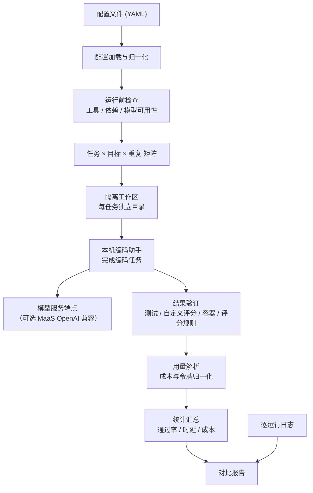

# 架构说明

## 1. 架构总览

本实践是一个**本地优先的 AI 编码助手评测工具**，用于在同一次运行中对比不同编码助手（或同一助手的不同模型）在成本、质量与时延上的表现。工具解析各编码助手自身产生的遥测数据（用量、令牌数、时延），并对助手产出的代码按任务验证规则打分，生成统一对比报告。

工具以 Python 命令行程序运行，不依赖云上基础设施：它读取使用者的配置与本地任务集，调用本机已安装的编码助手完成编码任务，再对结果做验证与评分。唯一可能涉及网络的环节是编码助手调用的模型服务端点；本实践推荐将该端点指向华为云模型即服务（MaaS）提供的 OpenAI 兼容接口，也兼容其它 OpenAI 兼容端点。



## 2. 组件与职责

| 组件 | 模块 | 职责 |
|---|---|---|
| 命令行入口 | `cli` | 提供两种评测模式的命令入口与参数解析 |
| 配置加载 | `config` / `targets` | 解析两类配置结构并归一化为统一的评测目标列表 |
| 数据模型 | `models` | 统一描述任务、目标、运行结果等核心对象 |
| 运行前检查 | `preflight` | 校验所需工具、仓库与模型是否就绪，提前暴露配置问题 |
| 沙箱工作区 | `sandbox` | 为每个任务与目标创建隔离目录，避免相互污染 |
| 评测编排 | `runner` | 编排任务 × 目标 × 重复次数的执行与评估 |
| 结果验证 | `verify` | 按任务声明的验证方式判定产出是否通过 |
| 评分 | `judge` | 对需要主观评分的任务调用评审助手按规则打分 |
| 用量解析 | `usage` | 解析各编码助手的用量数据，统一为成本与令牌口径 |
| 统计 | `stats` | 计算通过率、重复运行的置信区间等统计指标 |
| 日志 | `logger` | 逐运行记录人类可读日志，便于回溯 |

## 3. 两种评测模式

- **助手对比模式（`cli-compare`）**：同一组任务分别由多个编码助手执行，对比各助手在成本、质量与时延上的差异。
- **模型对比模式（`model-compare`）**：在同一个编码助手内切换不同模型，对比模型层面的差异。

两种模式共享同一套执行、验证、统计与报告内核，仅在目标生成与配置结构上有所不同。

## 4. 执行流程

1. **配置加载**：读取 YAML 配置，归一化为统一的评测目标。
2. **运行前检查**：确认所需命令行工具、任务仓库与模型可用，缺失项提前报告。
3. **任务执行**：为每个任务 × 目标在隔离工作区中运行编码助手；可配置重复次数以降低偶然性。
4. **结果验证**：按任务声明的验证方式判定——Python 测试、自定义评分脚本、容器运行或评分规则。
5. **用量与评分**：解析各助手的用量数据，对主观评分任务调用评审助手，汇总质量分。
6. **统计与报告**：计算通过率、时延与成本，输出统一对比报告。

## 5. 目录与代码布局

```text
application-intelligence-agent-cost-benchmark/
├── agent_cost_bench/            # 工具核心包（配置、编排、验证、统计、报告）
├── config.*.example.yaml        # 配置示例
├── tasks/                       # 内置任务集
├── tests/                       # 工具自身测试
├── run.sh                       # 交互式引导运行脚本
├── pyproject.toml               # 包与命令行入口定义
├── docs/                        # 架构说明与部署指南
└── README.md                    # 实践说明主文档
```

## 6. 关键设计决策

- **本地优先**：评测逻辑在本机运行，不要求云账号；是否需要网络仅取决于所选编码助手的模型端点。
- **统一内核**：两种评测模式共享执行与报告核心，配置层做差异化适配，避免逻辑分叉。
- **隔离工作区**：每个任务在独立目录执行，防止助手之间的文件改动相互干扰。
- **重复评测与统计**：支持对同一任务多次运行，用通过率与置信区间呈现稳定性，而非单次结果。
- **MaaS 兼容端点**：推荐将模型端点指向华为云 MaaS 的 OpenAI 兼容接口，便于在统一口径下对比模型。

## 7. 设计约束与已知限制

- 各编码助手需使用者自行安装并完成登录，工具不内置助手本体。
- 评测会调用所选模型端点并消耗对应额度，建议先用少量任务试运行确认范围。
- 评分规则类任务依赖评审助手，其结论带有一定主观性，应结合通过率等指标综合判断。
- 工具本身不含云基础设施，故无资源部署与销毁环节；安装与使用步骤见部署指南。
